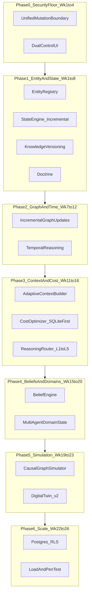
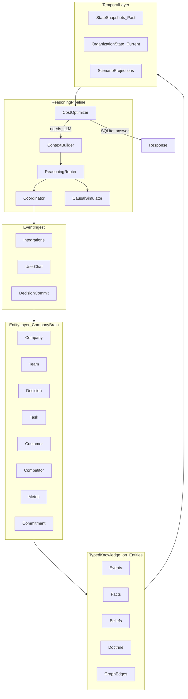
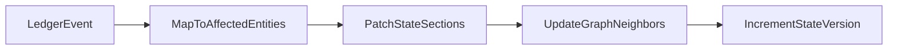
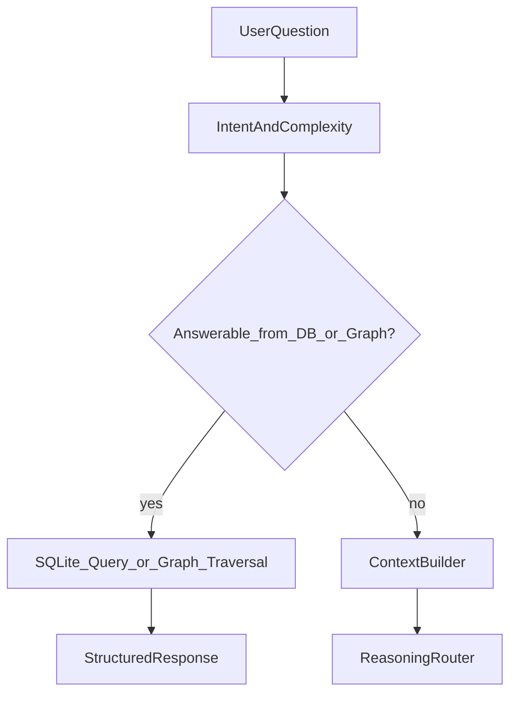
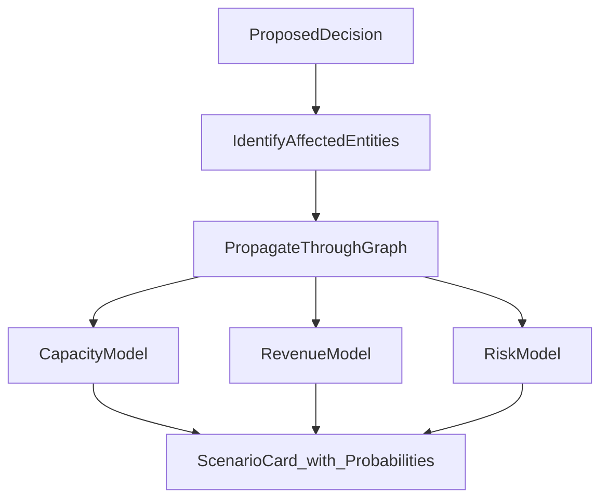
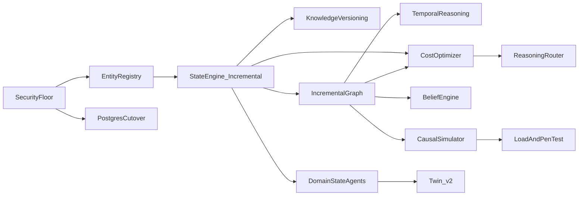

# Hustronix Enterprise Decision OS — 6-Month Execution Plan (v2)

## Strategic reorder (feedback incorporated)

**Principle:** The AI architecture is the moat; Postgres is an engineering enabler. Ship the **Company Brain** before horizontal scale.



**Parallel tracks:** Security floor (Phase 0) runs weeks 1–4 only. Entity/State (Phase 1) starts week 1 in parallel. Postgres deferred to Phase 6 (weeks 22–26).

---

## North-star architecture (entity-centric)

Everything revolves around **entities**; events, facts, beliefs, and state are **relationships and projections** on those entities.



**Leverage today (do not rewrite):**
- Ledger + auditor: [`apps/api/src/database.ts`](apps/api/src/database.ts), [`apps/api/src/auditor.ts`](apps/api/src/auditor.ts)
- Decision context: [`apps/api/src/intelligence/contextEngine.ts`](apps/api/src/intelligence/contextEngine.ts)
- Institutional v3 / Decision DNA: [`apps/api/src/institutional-reasoning.ts`](apps/api/src/institutional-reasoning.ts)
- Memory facts + provenance: [`apps/api/src/security/memory-fact.ts`](apps/api/src/security/memory-fact.ts)
- Evidence graph schema (extend, don't replace): [`apps/api/src/security/evidence-graph.ts`](apps/api/src/security/evidence-graph.ts)
- Epistemic derivation: [`apps/api/src/epistemic-engine.ts`](apps/api/src/epistemic-engine.ts)
- Security gateway: [`apps/api/src/security/security-gateway.ts`](apps/api/src/security/security-gateway.ts)

---

## Phase 0 (Weeks 1–4): Security floor (minimum to operate safely)

**Goal:** One enforcement model; unblock operators. **No Postgres cutover in this phase** — only fail-fast trap.

### 0.1 Unified mutation boundary

Extract `authorizeAndExecuteMutation()` in [`apps/api/src/security/security-gateway.ts`](apps/api/src/security/security-gateway.ts):
- RBAC → Tenant → Dual-control → Capability JTI → Audit

Wire all split paths in [`apps/api/src/server.ts`](apps/api/src/server.ts) and [`apps/api/src/agent.ts`](apps/api/src/agent.ts) (see v1 plan table: `execution/transition`, `decisions`, `link`, `kill`, WS tools).

### 0.2 Dual-control product UX

- `GET /api/security/approvals/pending`, `GET /api/security/approvals/:id`
- Settings **Approvals** panel; wire [`DecisionsPanel.tsx`](apps/web/src/components/mission/DecisionsPanel.tsx) and [`ExecuteClient.tsx`](apps/web/src/app/(dashboard)/execute/ExecuteClient.tsx)

### 0.3 Tenant scoping (`org_id`)

- Add `org_id` to ledger tables; migrate queries to `tenantSqlScope()`; ACTIVE conflict per `org_id`

### 0.4 Adaptive risk-based auto-linking

`LinkPolicyEngine` in [`apps/api/src/intelligence/autoLinker.ts`](apps/api/src/intelligence/autoLinker.ts):
- Deterministic matchers (task UUID, PR refs, issue keys) → auto low-impact
- Multi-factor score + impact tiers → auto / suggest / manual
- Reversible + auditable (`link_method`, `link_provenance_json`, `POST /api/execution/unlink`)

### 0.5 Cost and abuse controls

- WS rate limits on `text` / `COMMIT_DECISION`
- Org daily LLM budget (`ai:budget:{orgId}:{date}`)
- Redis rate limit store when `REDIS_URL` set

### 0.6 Demo cleanup

- Deprecate [`connections_manager.ts`](apps/api/src/connections_manager.ts); Signals UI → [`GET /api/integrations/health`](apps/api/src/integrations/connectionsHealth.ts)
- `bootstrap.ts`: **fail fast** if `DATABASE_TYPE=postgres` in production (trap removal only)

**Phase 0 exit:** dual-control commit works in UI; REST/agent policy parity; multi-member org lists shared data; adaptive linking live.

---

## Phase 1 (Weeks 1–8): Entity registry + State engine (AI moat starts here)

**Goal:** Build the **Company Brain** foundation — entities first, then compiled state with versioning and doctrine.

### 1.1 Entity-centric architecture (NEW — highest structural priority)

New module: `apps/api/src/entities/`

**Entity types** (extend existing `evidence_nodes.node_type`):
`company`, `team`, `decision`, `task`, `customer`, `competitor`, `metric`, `feature`, `commitment`, `meeting`, `person`, `project`

**Tables:**
- `entities` — `id`, `tenant_id`, `type`, `label`, `ref_id` (ledger FK), `metadata_json`, `confidence`, `freshness_at`
- Reuse/extend `evidence_edges` for all relationships (not parallel `memory_evidence` long-term)

**Rules:**
- Every signal, fact, belief, outcome **must** link to ≥1 entity
- Organization State is a **projection over entity subgraph**, not free text
- Auto-link policy scores **entity overlap** as primary factor

**API:** `GET /api/entities`, `GET /api/entities/:id/neighbors`, `GET /api/entities/:id/timeline`

### 1.2 Organization State compiler (incremental from day 1)

New: `apps/api/src/state/organization-state.ts`

**`OrganizationState` sections** (each with `confidence` + `freshness`):
- `objectives`, `priorities`, `activeDecisions`, `blockers`, `commitments`, `risks`
- `facts` (VERIFIED only), `beliefs` (placeholder until Phase 4), `doctrine`, `externalContext`
- `teams[]` (capacity slice), `meta.version`

**Incremental update model (NOT full recompile):**



- `patchOrganizationState(event)` — O(affected entities) not O(org)
- Debounce coalescing (500ms) merges patches in same window
- Full recompile only on: schema migration, corruption recovery, admin `POST /api/state/rebuild`

Replaces [`buildSupervisorPrompt`](apps/api/src/agent.ts) assembly with `formatOrganizationStateForPrompt(state, intent)`.

### 1.3 Knowledge versioning — Git for org state (NEW)

Table: `organization_state_versions`
- `version` (monotonic int), `tenant_id`, `snapshot_json`, `parent_version`, `diff_from_parent_json`, `compiled_at`, `trigger_event`, `author`

**API:**
- `GET /api/state/current` — latest version
- `GET /api/state/versions` — history
- `GET /api/state/diff?v1=&v2=` — what changed
- `POST /api/state/rollback?toVersion=` — owner-only; audit `STATE_ROLLBACK`

Enables: audit, compare, recover, answer "what was true last month?"

### 1.4 Doctrine — long-term strategic memory (NEW)

Table: `doctrine_rules`
- `statement` ("Never compete on price", "Enterprise first")
- `priority` (constitutional vs guidance)
- `status` (ACTIVE|SUPERSEDED)
- `entity_scope` (org-wide or team)
- Rarely changes; **cannot** be overridden by agent without owner + dual-control

Injected into every Organization State compile as `doctrine[]`. Simulator and router treat constitutional doctrine as hard constraints (L1 rules).

### 1.5 Dynamic confidence (NEW — not static 0.82)

Unified function in `apps/api/src/state/confidence.ts`:

```
confidence = f(
  base_evidence_weight,
  source_quality,
  evidence_count,
  contradiction_penalty,
  time_decay(half_life),
  freshness_bonus,
  human_verification_boost
)
```

Applied to: entities, facts, beliefs, links, state sections, recommendations.

Expose factors in all explain APIs (mirror [`explainMemoryFact`](apps/api/src/security/memory-fact.ts)).

### 1.6 Typed knowledge on entities

| Type | Store | Attaches to |
|------|-------|-------------|
| **Event** | `external_signals`, meetings | entities mentioned / linked |
| **Fact** | `memory_records` | customer, metric, feature, etc. |
| **Belief** | `beliefs` (Phase 4) | strategy, market entities |
| **Decision** | `decision_ledger` | decision + task entities |
| **Outcome** | `learning_log`, `decision_outcomes` | decision entity |
| **Doctrine** | `doctrine_rules` | company entity |

**Phase 1 exit:** Entity registry live; state compiler incremental; version diff API works; doctrine in prompt; dynamic confidence on all state sections.

---

## Phase 2 (Weeks 7–12): Knowledge graph + temporal reasoning

**Goal:** Incremental graph updates and past/current/future queries.

### 2.1 Incremental graph updates (NEW)

Extend [`evidence-graph.ts`](apps/api/src/security/evidence-graph.ts):

On event:
1. Upsert entity nodes for referenced IDs
2. `linkEvidence(from, to, edge_type)` — wire the currently unused `linkEvidence()`
3. Recompute confidence only for **patched nodes + 1-hop neighbors**
4. Emit `graph_patch` event → triggers state section patch (not full compile)

Unify `memory_evidence` into `evidence_edges` over time (migration script).

**Query API:**
- `GET /api/graph/impact?entityId=&direction=upstream|downstream&depth=3`
- Coordinator tools: `what_caused`, `what_depends_on`, `what_breaks_if`

### 2.2 Temporal reasoning (NEW)

Three temporal modes:

| Mode | Source | Questions answered |
|------|--------|-------------------|
| **Past** | `organization_state_versions` + ledger history | "What changed?", "What was true last month?" |
| **Current** | latest `OrganizationState` | operational truth |
| **Future** | scenario projections (Phase 5 simulator) | "What if we increase prices?" |

New: `apps/api/src/state/temporal.ts`
- `getStateAt(tenantId, timestamp)` — nearest version ≤ t
- `diffStates(v1, v2)` — entity-level diff
- `getEntityTimeline(entityId)` — events + confidence over time

Context builder loads temporal slice when query contains temporal intent ("last quarter", "since commit", "what changed").

### 2.3 World model as entity subgraph

Competitors, regulations, market conditions = **competitor/market entities** with `externalContext` projection (replaces unstructured `core_memory.world_model` JSON).

**Phase 2 exit:** Graph patches on ingest; impact queries work; temporal diff API; past-state questions answerable without LLM.

---

## Phase 3 (Weeks 11–16): Context builder + cost optimizer + reasoning router

**Goal:** Adaptive context and **SQLite-before-LLM** cost discipline.

### 3.1 Cost optimizer (NEW — before every LLM call)

New: `apps/api/src/reasoning/cost-optimizer.ts`



**Answerable without LLM (L0):**
- Ledger status queries ("what's ACTIVE?", "blocked tasks?")
- Entity neighbor lookups, temporal diffs
- Capacity/auditor rule outcomes
- Doctrine constraint checks

Log `reasoning_path: L0|L1|...` for cost analytics. Target: **60–80%** of routine questions never reach L4.

### 3.2 Adaptive context builder

New: `apps/api/src/state/context-builder.ts`

Intent classes → state sections + graph neighborhood + temporal slice:

| Intent | Loads |
|--------|--------|
| `strategy` | objectives, beliefs, doctrine, competitors, world entities |
| `execution` | tasks, blockers, capacity, signals |
| `incident` | high-risk signals, recent temporal delta, engineering domain state |
| `temporal` | version diff, entity timeline |
| `memory` | facts, beliefs, outcomes |

### 3.3 Reasoning router (L1–L5)

New: `apps/api/src/reasoning/router.ts`

| Level | Handler |
|-------|---------|
| L0 | Cost optimizer — SQLite/graph (NEW) |
| L1 | Auditor + doctrine rules |
| L2 | Heuristics (`signalDetector`, `operationalQuery`) |
| L3 | Fast LLM (`modelTier: fast`) |
| L4 | Coordinator premium |
| L5 | Dual-control human |

Entry: WS `text` → cost optimizer → router. Sub-agents ([`runSubAgent`](apps/api/src/agent.ts)) only invoked when router selects L3+.

**Phase 3 exit:** 60%+ chat turns resolved at L0–L2; context varies by intent; LLM cost telemetry dashboard.

---

## Phase 4 (Weeks 15–20): Belief engine + multi-agent domain state

**Goal:** Assumptions distinct from facts; specialist agents maintain domain slices.

### 4.1 Belief engine

New: `apps/api/src/beliefs/belief-engine.ts` (after graph + state exist)

- Beliefs attach to strategy/market **entities**
- `applyEvidence()` uses **dynamic confidence** formula
- Promote from decision `ranked_hypotheses` on ACTIVE commit
- Contradicting CONFIRMED belief → conflict + auditor signal

### 4.2 Multi-agent domain state ownership (NEW)

Each domain maintains a **DomainState** patch; coordinator merges into Organization State.

| Agent | Owns | Updates on |
|-------|------|------------|
| Engineering | blockers, tech debt, incidents, velocity | signals, execution transitions |
| Sales | pipeline, commitments, customer entities | CRM signals, meetings |
| Marketing | campaigns, positioning | research delegate, signals |
| Coordinator | merged `OrganizationState` | all domain patches |

Implementation:
- `domain_state_patches` table — `domain`, `section_json`, `version`
- Existing Marketing/Research sub-agents ([`agent.ts`](apps/api/src/agent.ts)) write **structured patches** (not prose) via new tools `update_domain_state`
- Merge function: `mergeDomainStates(patches) → OrganizationState` with conflict rules (doctrine wins; ACTIVE decision wins over domain)

### 4.3 Memory compression + garbage collection

Weekly job: `messages → facts → beliefs → doctrine candidates → state`
- GC: decay, archive, merge duplicates, supersede (uses dynamic confidence)

**Phase 4 exit:** Beliefs live with evidence links; domain patches merge correctly; compression runs weekly.

---

## Phase 5 (Weeks 19–23): Graph-based causal simulation + digital twin v2

**Goal:** Deterministic consequence modeling, not LLM simulation.

### 5.1 Causal graph simulator (NEW — replaces LLM-first simulator)

New: `apps/api/src/simulation/causal-simulator.ts`



- **Deterministic** propagation along `CAUSED_BY`, `DEPENDS_ON`, `AFFECTS` edges
- Numeric models: capacity hours, task fanout, simple revenue/churn templates from institutional v3 economics fields
- LLM narrative **only** when `risk > threshold` AND router selects L3 (optional prose layer)
- Store `simulation_runs` with `input_graph_hash`, `output_projection_json`

UI: **Simulate** on DRAFT decisions before commit.

### 5.2 Organizational digital twin

**v1 (week 19):** team capacity, workload, blockers (from Phase 1 `teams[]`)

**v2 (week 21–23):** richer team model per entity:
- `morale` (proxy: signal sentiment + blocker rate)
- `velocity` (tasks completed / week)
- `focus` (ACTIVE decision alignment %)
- `communication_load` (signal volume / team)
- `dependency_risk` (graph fan-in)
- `learning_rate` (`learning_log` entries / outcomes)

All metrics **computed deterministically** from ledger + graph; confidence scored.

### 5.3 Self-evaluation loop

On decision COMPLETED/REVERSED:
- `evaluateDecisionOutcome()` — expected vs actual
- Update entity confidences, belief posteriors, org learning rate
- Wire [`requireEpistemicSupport`](apps/api/src/security/epistemics.ts) for high-risk commits

**Phase 5 exit:** Simulate returns graph-propagated scenarios; twin v2 metrics in state; outcome loop updates beliefs.

---

## Phase 6 (Weeks 22–26): Postgres, scale proof, hardening

**Goal:** Horizontal scale after AI architecture is proven.

### 6.1 Postgres + RLS cutover

- Async repository; writes flip SQLite → Postgres
- RLS `SET app.current_org_id` per request
- Azure: worker Container App Job for cron/compression ([`infra/azure/README.md`](infra/azure/README.md))
- HTTP replicas > 1 enabled

### 6.2 MCP gateway

[`mcp.ts`](apps/api/src/mcp.ts) → `executeSecuredTool` only; default-deny in production

### 6.3 Load, chaos, external red team

Per [`docs/v9-trust-program-rollout.md`](docs/v9-trust-program-rollout.md):
- Soak 100–10k users; chaos scenarios; pen test
- Regressions → [`ops/scripts/security-redteam.test.ts`](ops/scripts/security-redteam.test.ts)

### 6.4 Documentation

New docs: `docs/organization-state.md`, `docs/entity-model.md`, `docs/belief-engine.md`, `docs/temporal-state.md`, `docs/causal-simulation.md`

**Enterprise exit targets:** Security 92+, Trust 90+, Reliability 90+, Enterprise Readiness 95+.

---

## Dependency graph (updated critical path)



---

## Expected impact (targets)

| Capability | Cost impact | Quality impact |
|------------|-------------|----------------|
| State-centric memory (vs chat RAG) | 80–95% token reduction | Fewer hallucinations |
| L0 SQLite + L1–L2 router | 60–80% fewer L4 calls | Faster responses |
| Incremental graph (vs full recompile) | Lower CPU | Fresher state |
| Graph causal simulator (vs LLM simulate) | Near-zero sim cost | Auditable projections |

---

## Risk mitigations

| Risk | Mitigation |
|------|------------|
| Entity model scope creep | Start with 8 types tied to existing ledger FKs; expand later |
| Incremental patch bugs | Version snapshots + rollback API; nightly full reconcile job |
| Domain state conflicts | Doctrine + ACTIVE decision precedence; merge audit log |
| Postgres delayed | SQLite + single replica OK until week 22; security floor still ships week 4 |
| Belief engine complexity | Deterministic confidence math; no LLM-created beliefs without validation |
| 6-month scope | Phase gates; twin v2 metrics can ship incrementally |

---

## Team split (reordered)

- **Stream A (Security, wk 1–4):** mutation boundary, approval UI, tenant, adaptive link, WS limits
- **Stream B (Company Brain, wk 1–20):** entities, state engine, versioning, doctrine, temporal, graph
- **Stream C (Reasoning, wk 11–20):** cost optimizer, context builder, router, beliefs, domain agents
- **Stream D (Simulation, wk 19–23):** causal simulator, twin v2, self-evaluation
- **Stream E (Scale, wk 22–26):** Postgres, load test, pen test

---

## v2 changelog (from review feedback)

| Addition | Phase |
|----------|-------|
| Entity-centric architecture | 1 |
| Temporal reasoning (past/current/future) | 2 |
| Incremental graph updates | 1–2 |
| Multi-agent domain state ownership | 4 |
| Doctrine (long-term strategic memory) | 1 |
| Graph-based causal simulation | 5 |
| Dynamic confidence (evidence × decay × freshness) | 1 |
| Knowledge versioning (Git-like) | 1 |
| Cost optimizer (SQLite before LLM) | 3 |
| Digital twin v2 | 5 |
| Phase reorder: AI moat before Postgres | all |
