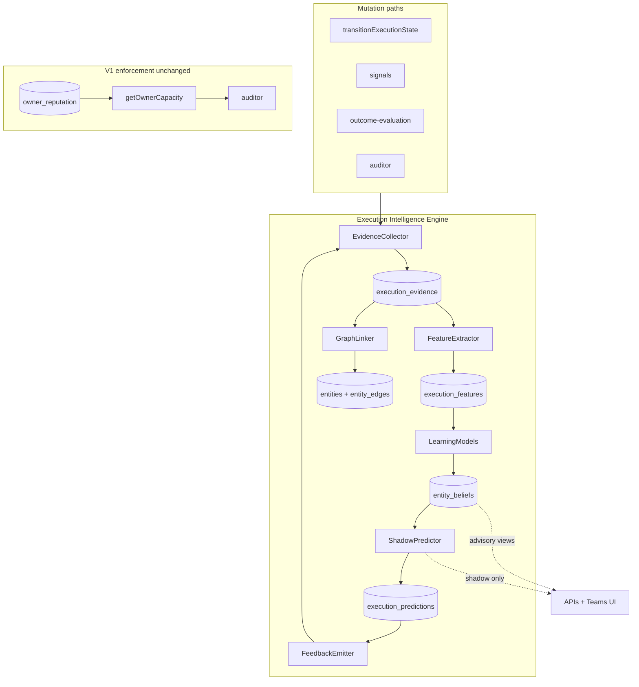

# Execution Intelligence Engine (V1)

## Goal

Evolve Hustronix from a single-scalar reputation loop (`reputation_modifier -= 0.1`) to a **platform learning capability**: immutable evidence → features → beliefs → predictions → outcomes → evidence. V1 ships the full loop for **owners** (`entity_type = person`) while the schema and engine are **entity-agnostic** so teams, projects, decisions, and customers reuse the same machinery later.

Long-term: retire `owner_reputation` when shadow predictions consistently beat the legacy heuristic.

---

## Principal review incorporated

| Review recommendation | V1 response |
|----------------------|-------------|
| Entity Intelligence, not Owner-only | Generic `entity_beliefs` + `execution_evidence.subject_entity_*`; owner APIs are views |
| Beliefs not Profiles | Store probabilistic beliefs (`mean`, `variance`, `n_obs`, `model_id`); no `owner_profile_dimensions` |
| Feature Store | `execution_features` between evidence and models |
| Model versioning | `model_version`, `feature_version`, `algorithm_version` on predictions |
| Knowledge graph | Link evidence to [entities](apps/api/src/entities/schema.ts) + `entity_edges`; causal graph deferred |
| Prediction error → evidence | `prediction.calibration_error` events close the loop |
| Capacity is derived | Store `performance_given_load` features; derive capacity at read time |
| Uncertainty everywhere | All belief/prediction API fields use `{ mean, confidence, n_obs }` |
| Explanations | Predictions include `explanation[]` with feature attributions |
| Rename to EIE | Module `execution-intelligence/`; distinct from narrative [beliefs](apps/api/src/beliefs/schema.ts) |

**Relationship to existing `beliefs` table:** Institutional/narrative beliefs ("we believe market X is growing") stay in `beliefs` + `belief_evidence`. Quantitative execution beliefs ("Alice is reliable with μ=0.91, σ=0.04") live in `entity_beliefs`. EIE may emit narrative belief candidates later; V1 keeps them separate.

---

## Architecture (timeless loop)



**Design rules ([architecture-enforcement.md](docs/architecture-enforcement.md)):**
- Evidence append-only; beliefs are **replayable** from evidence + features (no LLM in update path).
- Hook parallel to auditor in [bootstrap.ts](apps/api/src/bootstrap.ts).
- `owner_reputation` unchanged in V1; shadow mode only.

---

## V1 scope boundaries

| In V1 | Deferred |
|-------|----------|
| Generic evidence + features + beliefs schema | Full collaboration graph ingestion |
| Owner (`person`) beliefs: reliability, speed, planning, etc. | Auto-assignment enforcement |
| Feature extraction from ledger events | GitHub-deep expertise mining |
| Shadow predictions + explanations + versioning | Mission Control suggest-owner UI |
| Calibration feedback loop | Confidence calibration bins (Phase 2) |
| Derived shadow capacity from load-performance features | Replacing `getOwnerCapacity` in auditor |
| `GET` owner profile/calibration views | Graph causal reasoning engine |
| Teams UI with uncertainty + explanations | Entity types beyond `person` in UI |

---

## 1. Schema ([database.ts](apps/api/src/database.ts))

### `execution_evidence` (immutable ledger)

| Column | Purpose |
|--------|---------|
| `id` | UUID |
| `tenant_id` | Org scope |
| `event_type` | `task.completed`, `task.killed`, `signal.shadow_killed`, `decision.outcome`, `prediction.calibration_error`, … |
| `subject_entity_type` | `person`, `team`, `decision`, `task`, `project` (V1 writes `person` + `task`/`decision` as linked) |
| `subject_entity_id` | e.g. owner slug `alice` |
| `source_entity_type`, `source_entity_id` | What produced the event (task_id, signal_id) |
| `payload_json` | Raw facts: durations, attribution, load_at_event, prediction_id |
| `observed_at` | Event time |
| `idempotency_key` | Replay safety |

### `execution_features` (feature store)

| Column | Purpose |
|--------|---------|
| `id` | UUID |
| `tenant_id` | Org scope |
| `evidence_id` | FK to evidence |
| `entity_type`, `entity_id` | Subject |
| `feature_version` | e.g. `v1` — bump when extraction logic changes |
| `features_json` | Normalized features: `{ active_load, duration_ratio, attribution, domain_tokens, … }` |
| `extracted_at` | Timestamp |

Enables new features next year without rewriting historical evidence.

### `entity_beliefs` (probabilistic belief store)

| Column | Purpose |
|--------|---------|
| `tenant_id`, `entity_type`, `entity_id`, `belief_key` | Composite PK |
| `model_id` | e.g. `beta_v1`, `gaussian_v1` — algorithm swappable without schema change |
| `mean`, `variance`, `n_obs` | Posterior summary (Beta/Gaussian params in `params_json`) |
| `params_json` | `{ alpha, beta }` or Gaussian sufficient stats |
| `updated_at` | Last update |

**V1 belief keys for `person`:** `reliability`, `execution_speed`, `planning_accuracy`, `decision_quality`, `collaboration`, `learning_rate`, `ownership`, `focus`, `recovery_ability`, `consistency`, `risk_appetite`, `expertise:{domain}`, `performance_at_load:{bucket}`.

**Derived at read time (not stored):** `trust_score` (weighted composite), `derived_capacity` (from `performance_at_load:*` beliefs).

### `execution_predictions` (shadow + calibration)

| Column | Purpose |
|--------|---------|
| `id` | UUID |
| `tenant_id`, `entity_type`, `entity_id` | Subject |
| `prediction_type` | `task_success`, `on_time`, `capacity_headroom` |
| `predicted_value`, `actual_value` | Filled when outcome known |
| `confidence` | Model uncertainty |
| `explanation_json` | `[{ factor, weight, direction }]` |
| `features_json` | Snapshot used |
| `model_version`, `feature_version`, `algorithm_version` | Compare Bayesian V1 vs future models |
| `evidence_id` | Ties to triggering event |
| `created_at`, `resolved_at` | Lifecycle |

### `entity_edges` (lightweight knowledge graph, V1)

Extend or add alongside [entities](apps/api/src/entities/schema.ts):

| Column | Purpose |
|--------|---------|
| `tenant_id`, `from_type`, `from_id`, `to_type`, `to_id`, `edge_type` | e.g. `person:alice OWNS task:xyz`, `task:xyz PART_OF decision:abc` |
| `evidence_id` | Provenance |
| `created_at` | |

V1: auto-link on evidence ingest. Full causal reasoning deferred.

### Execution ledger extension

Add to `execution_ledger`:
- `estimated_duration_hours REAL`
- `attribution TEXT` — `owner_fault`, `external_blocker`, `requirements_gap`, `unknown`

---

## 2. Module: `apps/api/src/execution-intelligence/`

| File | Responsibility |
|------|----------------|
| `types.ts` | Evidence, Feature, EntityBelief, Prediction, Explanation |
| `evidence-collector.ts` | Mutations → `execution_evidence`; idempotency |
| `feature-extractor.ts` | Evidence → `execution_features` (versioned extractors) |
| `models/` | Pluggable `BeliefUpdateModel` (`beta_v1`, `gaussian_v1`) |
| `belief-engine.ts` | Features → posterior updates → `entity_beliefs` |
| `decay.ts` | Evidence weight via [confidence.ts](apps/api/src/state/confidence.ts) half-life |
| `graph-linker.ts` | Evidence → `entities` + `entity_edges` |
| `shadow-predictor.ts` | Beliefs + features → prediction + explanation |
| `feedback.ts` | Resolved prediction → `prediction.calibration_error` evidence |
| `derived-views.ts` | `trust_score`, `derived_capacity`, owner profile DTO |
| `replay.ts` | Rebuild beliefs from evidence (for algorithm fixes) |
| `index.ts` | `onLedgerEvent(ctx)`, `recordEvidence(...)`, `resolvePrediction(...)` |

### Evidence → features → beliefs (V1 handlers)

| Event | Features extracted | Belief keys updated |
|-------|-------------------|---------------------|
| `task.completed` (on time) | `duration_ratio`, `active_load`, `domain_tokens` | `execution_speed`, `reliability`, `performance_at_load:{bucket}`, `expertise:{domain}` |
| `task.completed` (late) | `planning_error_ratio` | `planning_accuracy`, `execution_speed` |
| `task.killed` | `attribution`, `active_load` | `reliability`, `ownership` (skip if `external_blocker`) |
| `task.blocked` → `task.completed` | `recovery_path` | `recovery_ability` |
| `signal.shadow_killed` | `source`, `grace_exceeded` | `reliability`, `ownership` |
| `signal.linked` | — | `collaboration` (small) |
| `decision.outcome` | `delta_score` | `decision_quality`, `learning_rate` on decision owner |
| `prediction.calibration_error` | `error_magnitude`, `prediction_type` | Tune model weights / belief priors on replay |

### Derived capacity (not stored)

At API read time:

```text
performance_at_load buckets → success rate curve
derived_capacity = max load where P(success) >= threshold (e.g. 0.85)
uncertainty = f(n_obs per bucket, posterior variance)
```

Expose alongside legacy `getOwnerCapacity()` for shadow comparison.

### Trust score (derived)

Weighted composite of belief means penalized by uncertainty: `mean * confidence` per dimension.

### Prediction explanations (required)

Every shadow prediction returns:

```json
{
  "predicted": 0.87,
  "confidence": 0.63,
  "explanation": [
    { "factor": "reliability", "belief_key": "reliability", "contribution": 0.31 },
    { "factor": "low_workload", "active_load": 2.1, "contribution": 0.24 },
    { "factor": "domain_match", "domain": "authentication", "contribution": 0.22 },
    { "factor": "recent_success_streak", "contribution": 0.10 }
  ],
  "model_version": "shadow_v1",
  "feature_version": "v1",
  "algorithm_version": "beta_gaussian_blend_v1"
}
```

---

## 3. Closed feedback loop

```text
ShadowPredictor logs prediction (execution_predictions)
        ↓
Outcome arrives (task.completed / killed)
        ↓
resolvePrediction(id, actual_value)
        ↓
compute calibration_error
        ↓
emit execution_evidence: prediction.calibration_error
        ↓
FeatureExtractor + BeliefEngine update on replay
```

Prediction errors are first-class evidence—not throwaway metrics.

---

## 4. Integration hooks

### Bootstrap ([bootstrap.ts](apps/api/src/bootstrap.ts))

```ts
db.setLedgerAuditorHook((ctx) => {
  auditor.onWrite(ctx);
  executionIntelligence.onLedgerEvent(ctx);
  onLedgerEventForState(ctx);
});
```

### Evidence emits

- [database.ts](apps/api/src/database.ts): `transitionExecutionState`, `saveExecutionTask`, signal link/kill
- [auditor.ts](apps/api/src/auditor.ts): `killExpiredSignal` → evidence (keep legacy `owner_reputation` UPDATE)
- [outcome-evaluation.ts](apps/api/src/evaluation/outcome-evaluation.ts): `decision.outcome`

### Entity registry bridge

On evidence ingest, ensure `entities` rows exist for `person:{owner}`, `task:{id}`, `decision:{id}` via [entities/store.ts](apps/api/src/entities/store.ts) `createEntity`.

---

## 5. APIs ([server.ts](apps/api/src/server.ts))

### Generic (future-proof)

| Endpoint | Purpose |
|----------|---------|
| `GET /api/intelligence/entities/:type/:id/beliefs` | All beliefs with `{ mean, confidence, n_obs, model_id }` |
| `GET /api/intelligence/entities/:type/:id/predictions` | Recent predictions + explanations |
| `GET /api/intelligence/entities/:type/:id/calibration` | Model accuracy by `algorithm_version` |
| `POST /api/intelligence/replay` | Operator: rebuild beliefs from evidence (admin) |

### Owner-centric views (V1 UX convenience)

| Endpoint | Maps to |
|----------|---------|
| `GET /api/owners/profiles` | `entity_type=person` summary + derived_capacity |
| `GET /api/owners/:owner/profile` | Beliefs + expertise keys + recent evidence + graph neighbors |
| `GET /api/owners/:owner/calibration` | Predictions filtered by owner |

### Enriched existing

- `GET /api/metrics/teams` — `beliefs` summary per member, `derivedCapacity` vs legacy, uncertainty on all fields
- `GET /api/execution/capacity` — `shadow: { derivedCapacity, confidence, explanation, legacyCapacity }`

Shared types: `packages/shared/src/execution-intelligence.ts` + [apps/web/src/data/types.ts](apps/web/src/data/types.ts).

---

## 6. Teams UI ([TeamsClient.tsx](apps/web/src/app/(dashboard)/teams/TeamsClient.tsx))

- Belief summary column: top 3 dimensions with uncertainty bars (`mean` ± confidence band).
- Tooltip: "Advisory intelligence — enforcement uses legacy capacity."
- Detail drawer: full beliefs, derived capacity curve (load vs success), prediction explanations, recent evidence, graph links (task → decision).
- Refactor teams handler to use [teamsMembers.ts](apps/api/src/teams/teamsMembers.ts).

---

## 7. Testing (`ops/scripts/execution-intelligence.test.ts`)

- Evidence idempotency
- Feature extraction version pinning
- Belief replay produces identical posteriors
- Time decay reduces old evidence weight
- `prediction.calibration_error` closes loop
- Derived capacity changes with load-performance beliefs; does not affect `getOwnerCapacity`
- Attribution `external_blocker` skips reliability penalty
- API returns uncertainty on every belief field
- Predictions include non-empty `explanation`
- Model version comparison query works

---

## 8. Bug fix (bundled)

[auditor.ts](apps/api/src/auditor.ts) `killExpiredSignal`: add `INSERT OR IGNORE INTO owner_reputation` before UPDATE.

---

## 9. Future phases

| Phase | Deliverable |
|-------|-------------|
| **2** | `team`, `decision`, `project` entity beliefs; confidence calibration bins |
| **3** | `POST /api/execution/suggest-owner` with explanations; Mission Control UI |
| **4** | Enforcement blend: `capacity = min(legacy, derived)` with admin flag + calibration gate |
| **5** | Retire `owner_reputation`; graph causal queries; narrative belief promotion from EIE |
| **6** | New `algorithm_version` models; compare via prediction log |

---

## Key files

| Area | Files |
|------|-------|
| Schema | [database.ts](apps/api/src/database.ts), [entities/schema.ts](apps/api/src/entities/schema.ts) |
| Engine | `apps/api/src/execution-intelligence/*` (new) |
| Hooks | [bootstrap.ts](apps/api/src/bootstrap.ts), [database.ts](apps/api/src/database.ts), [auditor.ts](apps/api/src/auditor.ts), [outcome-evaluation.ts](apps/api/src/evaluation/outcome-evaluation.ts) |
| API | [server.ts](apps/api/src/server.ts) |
| UI | [TeamsClient.tsx](apps/web/src/app/(dashboard)/teams/TeamsClient.tsx), [teamsMembers.ts](apps/api/src/teams/teamsMembers.ts) |
| Tests | `ops/scripts/execution-intelligence.test.ts` |
| Docs | [architecture-enforcement.md](docs/architecture-enforcement.md) |
