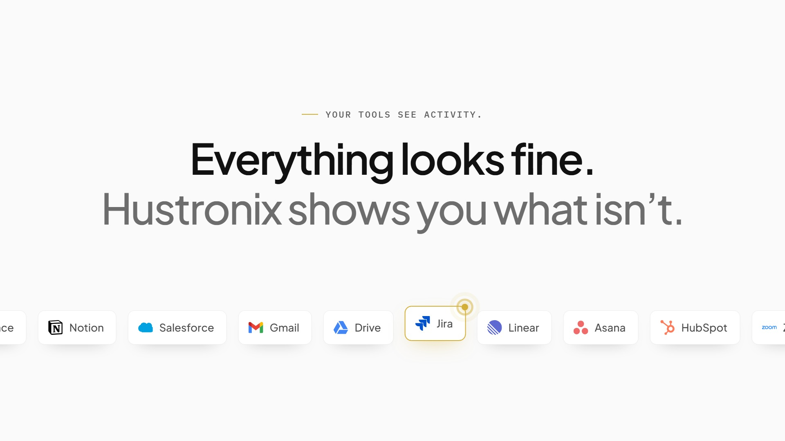
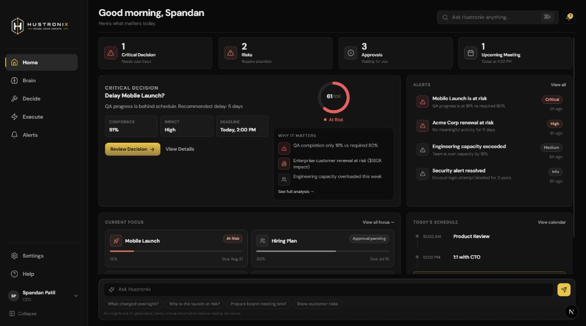
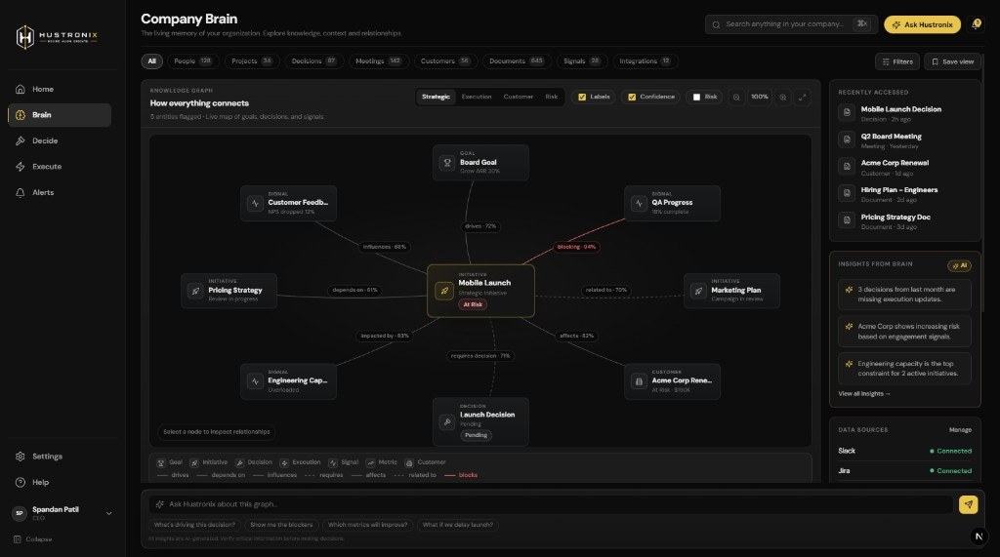
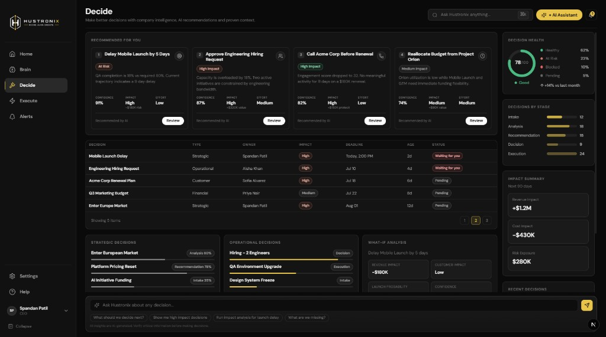
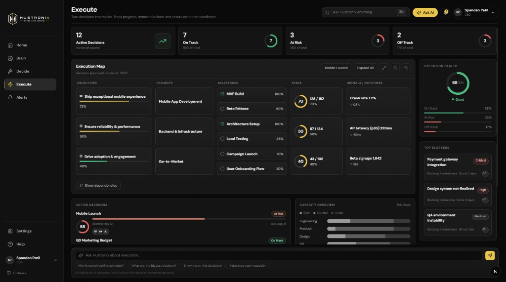
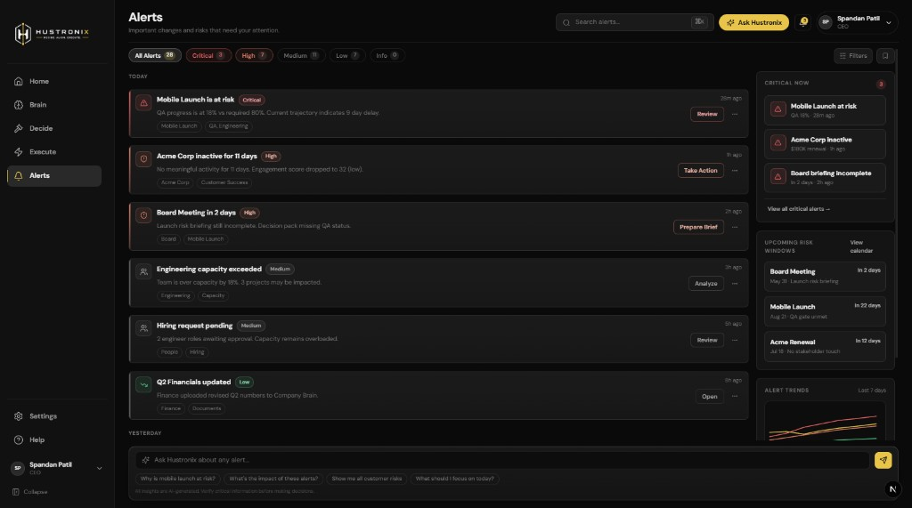
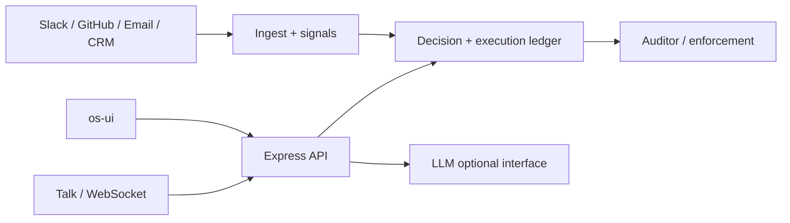

# Hustronix OS

**Decision and execution operating system for operators who are drowning in Slack, Jira, email, and meetings.**

Your tools see activity. Hustronix connects that activity into decisions, follow-up work, and risks — then keeps an auditable ledger of what was decided and what actually happened. The LLM/chat layer is an interface into that system, not a replacement for it.

<p align="center">
  
</p>

<p align="center">
  <a href="docs/assets/product/brag.mp4"><strong>▶ Watch the product video</strong></a>
  · ~22s · <code>docs/assets/product/brag.mp4</code>
</p>

---

## Who it helps

Founders, COOs, and ops leads who need to answer:

- What needs a decision *today*?
- Who is waiting on whom?
- What evidence supports this — and what is still noise?

## The problem

Cross-team launches fail quietly. A Jira slip, an unresolved launch date, and a customer promise each look harmless alone. Together they become a missed deadline or lost revenue. Dashboards show status; they rarely show the *chain*.

## What this repo is

A monorepo for the **Hustronix Decision OS**:

| Layer | Role |
| --- | --- |
| **Ledger** | Source of truth for decisions and follow-up work (SQLite) |
| **Auditor** | Deterministic enforcement / cron checks — not LLM whims |
| **Signals** | Ingest from Slack, GitHub, email, CRM, meetings, etc. |
| **os-ui** | Default product UI (Next.js App Router) |
| **API** | Express + WebSocket agent / Talk interface |

### Product UI

<p align="center">
  
</p>
<p align="center"><em>Home</em> — what needs attention today</p>

<p align="center">
  
</p>
<p align="center"><em>Company Brain</em> — how work, risk, and decisions connect</p>

<p align="center">
  
</p>
<p align="center"><em>Decide</em> — recommendations with confidence, impact, and owners</p>

<p align="center">
  
</p>
<p align="center"><em>Execute</em> — progress, blockers, and capacity</p>

<p align="center">
  
</p>
<p align="center"><em>Alerts</em> — risks ranked by severity and urgency</p>

### Product video

A short walkthrough of the “everything looks fine → connected risk → intervene” story lives in the repo:

- **File:** [`docs/assets/product/brag.mp4`](docs/assets/product/brag.mp4)  
- **Original working copy (local only):** `brag-output/brag.mp4` (gitignored media workspace)

Open the MP4 in any player, or download it from GitHub’s file browser.

---

## Implemented features (honest)

**Working in local/dev when configured:**

- Auth (register / login / session cookie), mission summary, decisions + commit, execution ledger, notifications, settings
- Signal ingest routes and Slack Events → `external_signals` (when Slack credentials are set)
- Chat / Talk over WebSocket into the ledger (requires a valid LLM API key)
- Security launch check (`npm run security:launch`)

**Partial / fixture-heavy in UI:**

- Some Brain catalogs and settings subpages still use mocks/fixtures
- Billing is stubbed; MFA UX on os-ui is minimal vs legacy web

**Experimental / scripts:**

- HSOG corpus, Talk validation harnesses, company-reality probes under `ops/scripts/` and `docs/hsog/`

**Not claimed:** production customer counts, ARR, or “multi-tenant SaaS at scale.” Runtime is SQLite-first; Postgres schema exists under `infra/db/postgres` but is not the default cutover.

---

## Architecture

```text
Integrations / webhooks / Nango (optional)
        ↓
  external_signals (evidence, not conclusions)
        ↓
  Decisions → execution ledger  ← source of truth
        ↓
  Auditor (cron + mutation hooks)
        ↓
  REST (auth + RBAC) + WebSocket /ws
        ↓
  apps/os-ui  (same-origin /api proxy → API :3005)
```



---

## Tech stack

- **API:** Node.js, Express, WebSocket, TypeScript, SQLite (`better-sqlite3`)
- **UI:** Next.js App Router (`apps/os-ui`, default), legacy UI in `apps/web`
- **LLM:** Anthropic and/or OpenAI (optional; required for Talk)
- **Integrations:** Slack, GitHub, Google, Microsoft, Notion, Jira, Linear (OAuth + webhooks; each needs its own env)
- **Marketing:** `netlify-landing/`
- **Deploy sketches:** Docker, Fly.io, Azure Container Apps (`infra/`)

---

## Repository layout

```text
apps/
  api/                 Express API, WebSocket, agent, SQLite
  os-ui/               Default Decision OS UI (Next.js)
  web/                 Legacy mission-control UI
packages/shared/       Shared DTOs / contracts
infra/                 Docker, Fly, Azure, Postgres schema
ops/scripts/           QA, HSOG, security checks
docs/                  Architecture, security, QA notes
docs/assets/product/   README screenshots + brag.mp4
netlify-landing/       Marketing / early-access site
data/                  Local SQLite (gitignored except .gitkeep)
```

---

## Prerequisites

- Node.js **20+** (CI uses **22**)
- npm workspaces
- Optional: Anthropic and/or OpenAI API key for Talk
- Optional: provider OAuth credentials for live integrations

---

## Quick start

```bash
npm install
cp .env.example .env
cp apps/os-ui/.env.example apps/os-ui/.env.local
npm run dev
```

Open **http://localhost:3000** (UI). API listens on **http://localhost:3005**.

| Command | What it runs |
| --- | --- |
| `npm run dev` | API + os-ui |
| `npm run dev:api` | API only (`:3005`) |
| `npm run dev:web` | os-ui only (`:3000`) |
| `npm run dev:web:legacy` | legacy `apps/web` |
| `npm run dev:unified` | unified single-process mode |

Create a local login (optional helper):

```bash
npx tsx ops/scripts/create-login-account.ts
# default username/password printed by the script
```

---

## Environment

- **Root `.env`** — API secrets and integration credentials (never commit real values).
- **`apps/os-ui/.env.local`** — `API_PROXY_TARGET` (default `http://127.0.0.1:3005`) so the browser can use same-origin `/api/*` with cookies.

Important variables (see `.env.example` for the full list):

| Variable | Purpose |
| --- | --- |
| `ALLOWED_ORIGINS` | Browser origins allowed to call the API (e.g. `http://localhost:3000`) |
| `APP_ORIGIN` | Public UI origin for OAuth redirects |
| `SQLITE_PATH` | SQLite file (default `./data/hustronix.db`) |
| `ANTHROPIC_API_KEY` / `OPENAI_API_KEY` | LLM for Talk / coordinator |
| `OAUTH_TOKEN_ENCRYPTION_KEY` | Required before storing integration tokens |
| `SLACK_*`, `GITHUB_OAUTH_*`, … | Per-provider ingest OAuth |

Boot logs print a `📡 Integrations:` summary so you can see which providers are live.

---

## Tests and checks

```bash
npm run security:launch          # static security allowlist / launch checks
npx tsx apps/os-ui/src/lib/live-mappers.check.ts
npm run build:shared
# Optional deeper suites (many touch local SQLite / HSOG):
# npm run test:operating-loop
# npm run qa:ui
```

**Note:** `npm run build:api` / full `next build` for os-ui may currently fail TypeScript checks in parts of the tree. Local `npm run dev` (tsx + Next dev) is the supported day-to-day path until those errors are cleared. Do not assume CI green without verifying.

Health check when the API is up:

```bash
curl http://127.0.0.1:3005/api/health
```

---

## Production sketches

Unified process (API + UI on one port):

```bash
npm run build
NODE_ENV=production PORT=3000 npm run start:unified
```

Docker / Fly / Azure notes: [`infra/`](infra/), [`infra/azure/README.md`](infra/azure/README.md).

Before any real deploy: rotate keys, set HTTPS origins, persist `SQLITE_PATH`, and run `npm run security:launch`.

---

## Current limitations

- SQLite single-node default; Postgres is schema/migrate only until cutover
- Many OAuth integrations are optional — unset env = disabled at boot
- Some UI surfaces still fixture-backed
- LLM quality depends on your keys and spend controls (`LLM_COST_SAVER` defaults on)

---

## Documentation

| Doc | Topic |
| --- | --- |
| [`apps/os-ui/README.md`](apps/os-ui/README.md) | Product UI routes ↔ API |
| [`apps/api/README.md`](apps/api/README.md) | API workspace |
| [`docs/`](docs/) | Architecture, security rollouts, HSOG/QA reports |
| [`docs/assets/product/`](docs/assets/product/) | Screenshots + [`brag.mp4`](docs/assets/product/brag.mp4) |

---

## Security

- Never commit `.env`, databases, or outreach lists (`leads.csv` is ignored).
- Report issues privately if you find a vulnerability in a deployment you operate.
- Example credentials in QA scripts are synthetic only.

---

## License

[MIT](LICENSE) © 2026 Hustronix
