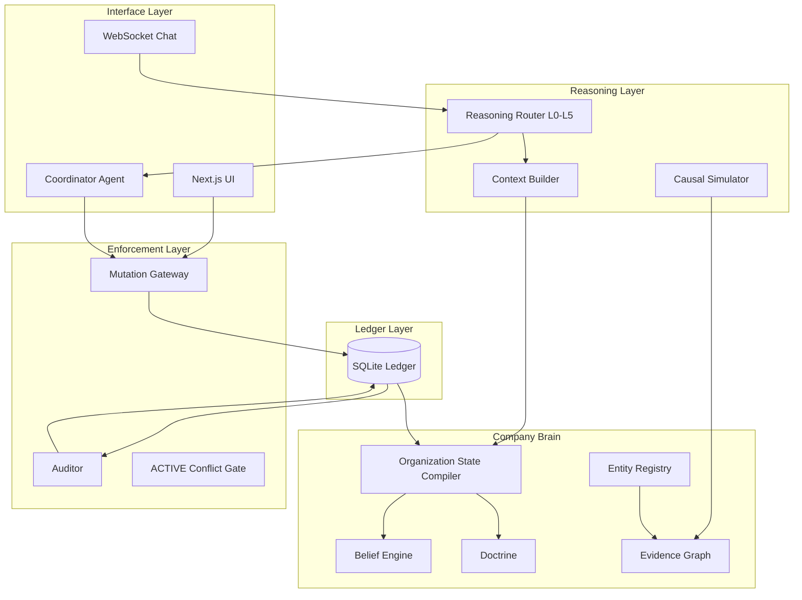
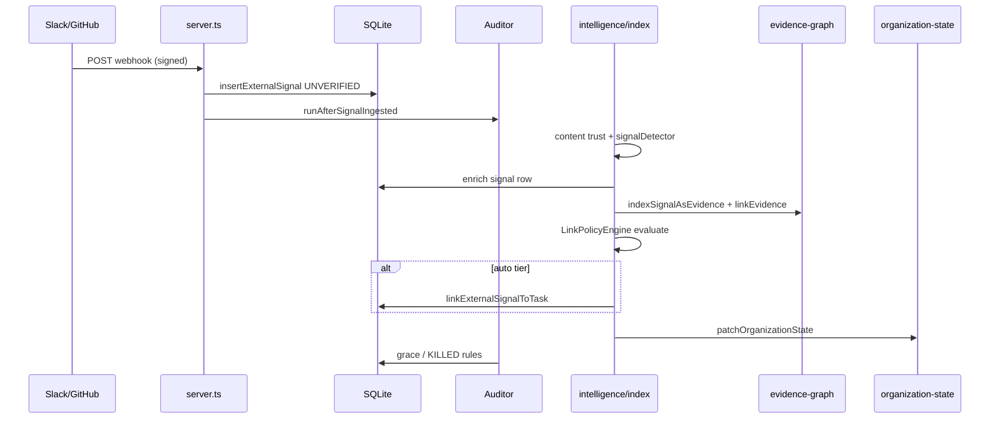
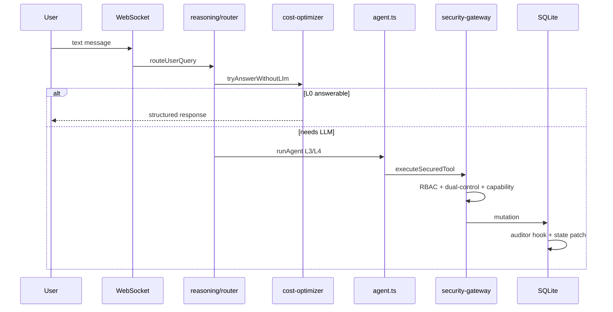

# Hustronix OS — Complete Architecture Report

**Version:** 2.0 (Decision OS / Company Brain)  
**Report date:** June 27, 2026  
**Audience:** Founders, staff engineers, and architects evaluating Hustronix as a Decision Operating System  
**Companion docs:** [`security-assessment-2026-06.md`](security-assessment-2026-06.md), [`HUSTRONIX-COMPLETE-TECHNICAL-GUIDE.md`](HUSTRONIX-COMPLETE-TECHNICAL-GUIDE.md)

---

## How to read this document

| If you want to understand… | Start here |
| --- | --- |
| What Hustronix *is* architecturally | §1 Executive Summary |
| The v2 “Company Brain” model | §3 North-Star Architecture |
| How events become state and LLM context | §5 Data Flow |
| Ledger vs auditor vs agent | §6.1–6.2 |
| Entity-centric memory and beliefs | §6.3–6.5 |
| AI reasoning tiers (L0–L5) | §6.7 |
| Security and mutation boundaries | §6.8 |
| What's production-ready vs deferred | §12 Maturity Matrix |

**Core idea in one sentence:** Hustronix is a **Decision Operating System** where **events compile into organization state**, **deterministic rules enforce the ledger**, and **LLMs reason over compact state** — not chat archives.

---

## 1. Executive Summary

### 1.1 Product architecture

Hustronix evolved from a **three-layer enforcement kernel** (ledger → auditor → UI/agent) into a **state-centric Decision OS**:

| Era | Model | Primary context for AI |
| --- | --- | --- |
| **v1** | Ledger + auditor + chat RAG | Recent messages, decision context snapshot |
| **v2 (current)** | Entity graph + Organization State compiler | Compiled state, doctrine, beliefs, adaptive context |

The LLM is an **interface and reasoning engine**, not the source of truth. Durable state lives in SQLite (Postgres cutover planned), enforced by the auditor and unified mutation gateway.

### 1.2 Architectural principles

1. **Ledger authority** — `decision_ledger`, `execution_ledger`, `external_signals` are canonical for commitments and work.
2. **Deterministic enforcement** — capacity, shadow work, ACTIVE conflict, grace windows run without LLM involvement.
3. **State over chat** — Organization State is compiled from entities and ledger events; chat is not long-term memory.
4. **Entity-centric knowledge** — facts, beliefs, signals, and outcomes attach to typed entities (Company Brain).
5. **Typed knowledge** — events, facts, beliefs, decisions, doctrine, and outcomes have distinct lifecycles.
6. **Cost-aware reasoning** — L0 SQLite/graph answers before premium LLM calls.
7. **Unified security boundary** — REST, WebSocket, and agent tools share the same mutation authorization path.

### 1.3 Technology stack

| Layer | Technology | Location |
| --- | --- | --- |
| API + WebSocket | Node.js, Express, `ws` | `apps/api/src/server.ts` |
| Production server | Unified (API + Next.js) | `apps/api/src/unified-server.ts` |
| Database (runtime) | SQLite (`better-sqlite3`) | `apps/api/src/database.ts` |
| Database (target) | PostgreSQL + RLS | `infra/db/postgres/001_initial_schema.sql` |
| Frontend | Next.js App Router | `apps/web/` |
| LLM | Anthropic (default) / OpenAI | `apps/api/src/llm.ts` |
| Deploy target | Azure Container Apps | `infra/azure/` |

---

## 2. Architectural Vision

### 2.1 From assistant to operating system

Standard AI assistants retrieve text and reconstruct context each turn. Hustronix maintains a **continuously updated organizational model**:

```text
Events (Slack, GitHub, meetings, commits)
        ↓
Entity graph + ledger mutations
        ↓
Organization State (versioned, confidence-scored)
        ↓
Adaptive Context Builder (intent-based)
        ↓
Reasoning Router (L0–L5)
        ↓
Coordinator / Simulator / Human approval
        ↓
Ledger write (through secured mutation boundary)
```

### 2.2 Separation of concerns



---

## 3. North-Star Architecture (v2)

### 3.1 Entity-centric Company Brain

Everything durable attaches to **entities**; relationships are graph edges.

**Entity types:** `company`, `team`, `decision`, `task`, `customer`, `competitor`, `metric`, `feature`, `commitment`, `meeting`, `person`, `project`

| Concept | Store | Module |
| --- | --- | --- |
| Entities | `entities` | `apps/api/src/entities/` |
| Graph edges | `evidence_nodes`, `evidence_edges` | `apps/api/src/security/evidence-graph.ts` |
| Facts | `memory_records` | `apps/api/src/security/memory-store.ts` |
| Beliefs | `beliefs`, `belief_evidence` | `apps/api/src/beliefs/belief-engine.ts` |
| Doctrine | `doctrine_rules` | `apps/api/src/state/doctrine.ts` |
| State snapshots | `organization_state_versions` | `apps/api/src/state/versioning.ts` |

See [`entity-model.md`](entity-model.md).

### 3.2 Organization State

Compiled projection injected into coordinator prompts (`ORG_STATE_ENABLED=1` default):

**Sections:** `objectives`, `priorities`, `activeDecisions`, `blockers`, `commitments`, `risks`, `facts`, `beliefs`, `doctrine`, `externalContext`, `teams[]`, `meta`

**Update model:** Incremental `patchOrganizationState()` on ledger events (500ms debounce); full `rebuildOrganizationState()` on nightly cron and `POST /api/state/rebuild`.

See [`organization-state.md`](organization-state.md).

### 3.3 Typed knowledge lifecycles

| Type | Example | Lifecycle |
| --- | --- | --- |
| **Event** | Slack message ingested | UNVERIFIED → GRACE → LINKED / KILLED |
| **Fact** | "Churn = 8%" | UNVERIFIED → VERIFIED (claim validation) |
| **Belief** | "Enterprise converts better" | PROPOSED → CONFIRMED / REFUTED |
| **Decision** | Strategic vow | DRAFT → ACTIVE → COMPLETED |
| **Doctrine** | "Never compete on price" | ACTIVE (constitutional) → SUPERSEDED |
| **Outcome** | Post-decision measurement | Recorded in `learning_log`, `decision_outcomes` |

### 3.4 Temporal reasoning

| Mode | Source | Use |
| --- | --- | --- |
| **Past** | `organization_state_versions`, ledger history | "What changed last month?" |
| **Current** | Latest compiled state | Operational truth |
| **Future** | Causal simulator | "What if we raise prices?" |

See [`temporal-state.md`](temporal-state.md).

### 3.5 Multi-agent domain state

Specialist sub-agents (Marketing, Research) write **`domain_state_patches`** for `engineering`, `sales`, `marketing`. Coordinator merges via `mergeDomainStates()` with precedence: **doctrine > ACTIVE decision > domain patch**.

Module: `apps/api/src/state/domain-state.ts`, tool: `update_domain_state`.

---

## 4. Layer Model (Evolved)

### Layer 1 — Ledger (source of truth)

**Tables:** `decision_ledger`, `execution_ledger`, `external_signals`, `audit_log`, `learning_log`, `messages`

**Module:** `apps/api/src/database.ts`

**Tenant key:** `org_id` (backfilled; legacy `user_id` retained for back-compat via `tenant-scope.ts` IN-clause)

### Layer 2 — Enforcement (deterministic)

**Auditor:** shadow work, grace windows, capacity, NO-list, structural collapse  
**Module:** `apps/api/src/auditor.ts`

**Gates:**
- ACTIVE decision conflict (one ACTIVE per org)
- Dual-control approvals for high-risk mutations
- Content trust / injection block on ingest

**Triggers:** Event-driven on ledger writes + cron every 5 minutes (`bootstrap.ts`)

### Layer 3 — Company Brain (compiled knowledge)

**Modules:** `entities/`, `state/`, `beliefs/`, `security/evidence-graph.ts`

**Outputs:** Organization State, graph impact queries, belief confidence, digital twin metrics

### Layer 4 — Reasoning (cost-aware AI)

**Modules:** `reasoning/cost-optimizer.ts`, `reasoning/router.ts`, `state/context-builder.ts`

**Levels:**

| Level | Handler | When |
| --- | --- | --- |
| L0 | SQLite / graph query | Status, blocked tasks, entity neighbors |
| L1 | Doctrine + auditor rules | Constitutional violations |
| L2 | Heuristics (`operationalQuery`, signal detector) | Drift, overload, triage |
| L3 | Fast LLM (Haiku-class) | Classification, enrichment |
| L4 | Premium LLM (Sonnet-class) | Strategic, institutional reasoning |
| L5 | Human dual-control | Commit, transition, high-risk |

### Layer 5 — Interface

**UI:** Mission Control, Execute, Signals, Chat, Settings, Reports  
**Web app:** `apps/web/src/app/(dashboard)/`  
**Real-time:** WebSocket chat streaming (`wireWebSocketHandlers` in `server.ts`)

---

## 5. End-to-End Data Flow

### 5.1 Signal ingest → enforcement → intelligence



### 5.2 User chat → reasoning → mutation



### 5.3 Decision commit path

1. DRAFT created via `POST /api/decisions` or `log_strategic_decision` (institutional v3 JSON)
2. Optional: `POST /api/decisions/simulate` (causal graph propagation)
3. Dual-control: two approvers via Settings → Approvals
4. Commit: `POST /api/decisions/commit` or WS `COMMIT_DECISION` with `approvalId`
5. `requireCausalValidationForActivation` + epistemic support gate
6. `transitionDecisionState(ACTIVE)` — conflict gate per `org_id`
7. Belief promotion from `ranked_hypotheses`
8. Outcome evaluation on COMPLETED/REVERSED

---

## 6. Core Subsystems

### 6.1 Ledger and database

**File:** `apps/api/src/database.ts`

| Domain | Key operations |
| --- | --- |
| Decisions | `saveDecisionEvent`, `transitionDecisionState`, `getActiveDecision` |
| Execution | `transitionExecutionState`, `getActiveExecutions` |
| Signals | `insertExternalSignal`, `linkExternalSignalToTask`, `killSignal` |
| Memory | Via `security/memory-store.ts` |
| Search | FTS5 mirrors + `entity_embeddings` |

**Schema extensions (v2):** `org_id` on ledger tables, `link_method`, `link_provenance_json`, V7–V9 security tables, entity/state/belief/simulation tables.

**Repository foundation (Phase 6):** `apps/api/src/db/repository.ts`, `sqlite-adapter.ts` — async interface for future Postgres cutover.

### 6.2 Auditor

**File:** `apps/api/src/auditor.ts`

**Rules (deterministic):**
- Shadow work: unlinked signals after grace → KILLED
- Capacity overload hints
- NO-list constraint breaches
- Structural collapse (task failure rates)

**Hook chain** (`bootstrap.ts`):

```typescript
db.setLedgerAuditorHook((ctx) => {
  auditor.onWrite(ctx);
  onLedgerEventForState(ctx);
});
```

### 6.3 Entity registry

**Path:** `apps/api/src/entities/`

| API | Purpose |
| --- | --- |
| `GET /api/entities` | List tenant entities |
| `GET /api/entities/:id/neighbors` | Graph neighborhood |
| `GET /api/entities/:id/timeline` | Temporal entity history |

Evidence graph syncs entity rows on node upsert (`evidence-graph.ts`).

### 6.4 Organization State compiler

**Path:** `apps/api/src/state/organization-state.ts`

| API | Purpose |
| --- | --- |
| `GET /api/state/current` | Latest compiled state |
| `GET /api/state/versions` | Version history |
| `GET /api/state/diff?v1=&v2=` | Diff between versions |
| `POST /api/state/rollback?toVersion=` | Owner-only rollback |
| `POST /api/state/rebuild` | Owner/admin full rebuild |

**Prompt integration:** `buildSupervisorPrompt` in `agent.ts` calls `formatOrganizationStateForPrompt(state, intent)` when `ORG_STATE_ENABLED=1`.

**Digital twin:** `apps/api/src/state/digital-twin.ts` — team morale, velocity, focus, communication load, dependency risk, learning rate.

### 6.5 Belief engine

**Path:** `apps/api/src/beliefs/belief-engine.ts`

| API | Purpose |
| --- | --- |
| `GET /api/beliefs` | List beliefs |
| `GET /api/beliefs/:id/explain` | Confidence factors + evidence |

Promotion from institutional v3 `ranked_hypotheses` on ACTIVE commit. See [`belief-engine.md`](belief-engine.md).

### 6.6 Intelligence pipeline

**Orchestrator:** `apps/api/src/intelligence/index.ts`

**Pipeline per signal:**

1. `fetchDecisionContext` — cheap sync context
2. Content trust pipeline — block MALICIOUS before LLM
3. `detectSignal` (LLM + heuristic fallback)
4. `applyEnrichment` — persist to signal row
5. `ensureEmbedding` — when linking is possible
6. `LinkPolicyEngine` — adaptive auto / suggest / manual
7. Graph patch — `wireSignalGraphOnIngest`
8. `patchOrganizationState`

**Cost gates:** Skip LLM/embed when noise, no active decision, or already enriched.

**Search:** `hybridSearch.ts` — FTS5 + embedding similarity  
**Auto-link policy:** `intelligence/link-policy.ts` — deterministic matchers + multi-factor score

### 6.7 Agent and reasoning stack

#### Coordinator (`agent.ts`)

- Entry: `runAgent(userId, userInput, …)`
- Router: `routeUserQuery` before LLM (`reasoning/router.ts`)
- L0 short-circuit returns without LLM when answerable
- Tools via `executeSecuredTool` (secured gateway)
- Sub-agents: Marketing, Research (`runSubAgent`, fast tier)
- Institutional v3 required for `log_strategic_decision`

#### Assistant (`assistant-agent.ts`)

Product-help drawer only — `get_current_time` tool; no ledger mutation.

#### Decision context (legacy hot path)

`intelligence/contextEngine.ts` — `fetchDecisionContext`, `formatForPrompt` still used alongside Organization State.

#### Institutional reasoning

`institutional-reasoning.ts` — v3 memo schema, causal validation checklist, activation gates.

`epistemic-engine.ts` — derived confidence, `attachEpistemicDerivation`.

#### Causal simulator

`simulation/causal-simulator.ts` — graph propagation, capacity/revenue/churn templates  
**API:** `POST /api/decisions/simulate`  
See [`causal-simulation.md`](causal-simulation.md).

#### Memory compression

`state/memory-compression.ts` — weekly cron (Sun 03:00), GC hooks in `memory-store.ts`.

### 6.8 Security and mutation boundary

**Unified gateway:** `apps/api/src/security/security-gateway.ts`

| Function | Role |
| --- | --- |
| `authorizeAndExecuteMutation` | REST mutations |
| `executeSecuredTool` | Agent tools |
| `gateUserChatInput` | Pre-LLM chat scan |
| `authorizeSecuredMutation` | Policy wrapper |

**Shared handlers:** `security/mutation-handlers.ts` — commit, transition, link, unlink, kill

**High-risk actions:** dual-control via `approval-gate.ts` (all roles, no bypass)

Full security detail: [`security-assessment-2026-06.md`](security-assessment-2026-06.md)

### 6.9 Integrations

**Registry:** `auth/oauthProviders.ts`

| Provider | Ingest | Verification |
| --- | --- | --- |
| Slack | Events API | HMAC `SLACK_SIGNING_SECRET` |
| GitHub | Webhooks | `GITHUB_WEBHOOK_SECRET` |
| Google, Microsoft, Jira, Linear, Notion | OAuth + workers/webhooks | Per-provider |

**Normalized path:** `integrations/ingestRouter.ts` → `external_signals` → auditor → intelligence

**Health UI:** `GET /api/integrations/health` (replaces deprecated `connections_manager` mock)

See [`integration-backlog.md`](integration-backlog.md), [`agents-and-slack-signals.md`](agents-and-slack-signals.md).

### 6.10 Notifications

**Dispatcher:** `notifications/dispatcher.ts`  
Channels: in-app, email (SMTP), Slack DM, digest scheduler

---

## 7. Frontend Architecture

**Framework:** Next.js App Router (`apps/web/`)

| Route | Purpose |
| --- | --- |
| `/mission-control` | Active decision, capacity, signals summary |
| `/execute` | Execution ledger, transitions (with approval flow) |
| `/signals` | Signal triage, integration health |
| `/chat` | WebSocket coordinator |
| `/settings` | Org profile, notifications, **Approvals** panel |
| `/reports` | Drift, weekly reports |

**Key components:**
- `DecisionsPanel.tsx` — commit with `approvalId`
- `ExecuteClient.tsx` — transitions with `approvalId`
- `ApprovalsPanel.tsx` — dual-control admin UI
- `SignalsClient.tsx` — integrations health

**Org context:** `apps/web/src/lib/org-context.ts` — onboarding digest → `core_memory.organization`

---

## 8. API Surface (Architectural Groupings)

### 8.1 Ledger mutations (secured)

| Method | Route | Gateway |
| --- | --- | --- |
| POST | `/api/decisions` | ✅ |
| POST | `/api/decisions/commit` | ✅ |
| POST | `/api/execution/transition` | ✅ |
| POST | `/api/execution/link` | ✅ |
| POST | `/api/execution/unlink` | ✅ |
| POST | `/api/execution/signals/kill` | ✅ |

### 8.2 Company Brain (read-mostly)

| Method | Route |
| --- | --- |
| GET | `/api/entities`, `/api/entities/:id/neighbors`, `/api/entities/:id/timeline` |
| GET | `/api/state/current`, `/api/state/versions`, `/api/state/diff` |
| POST | `/api/state/rollback`, `/api/state/rebuild` |
| GET/POST | `/api/doctrine` |
| GET | `/api/beliefs`, `/api/beliefs/:id/explain` |
| GET | `/api/graph/impact` |
| GET | `/api/truth/current` |
| GET | `/api/memory/facts/:id/explain` |

### 8.3 Intelligence and simulation

| Method | Route |
| --- | --- |
| GET | `/api/intelligence/context`, `/api/intelligence/search` |
| POST | `/api/decisions/simulate` |
| GET | `/api/operational/drift`, `/overloaded`, `/conflicts` |

### 8.4 Security and governance

| Method | Route |
| --- | --- |
| GET | `/api/security/approvals/pending`, `/api/security/approvals/:id` |
| POST | `/api/security/approvals/:id/approve` |
| GET | `/api/security/dashboard`, `/api/trust/metrics` |

### 8.5 Real-time

| Channel | Events |
| --- | --- |
| WebSocket | `text`, `COMMIT_DECISION`, `load_session`, `history`, `text_chunk` |

---

## 9. Data Model Overview

### 9.1 Core ledger

```text
decision_ledger ──< execution_ledger
       │
       └── external_signals (link via linked_execution_id)
```

**Decision states:** DRAFT → ACTIVE → COMPLETED / ARCHIVED / SUPERSEDED / REVERSED  
**Signal states:** UNVERIFIED → GRACE → LINKED / KILLED  
**Execution states:** PENDING → ACTIVE → BLOCKED → COMPLETED / KILLED

### 9.2 Company Brain tables

```text
entities ── evidence_edges ── evidence_nodes
    │
    ├── memory_records (facts)
    ├── beliefs ── belief_evidence
    ├── doctrine_rules
    └── organization_state_versions
```

### 9.3 Security and audit

```text
pending_action_approvals
agent_action_audit
security_events / security_events_v8
capability_jti_log
memory_provenance_events
ledger_events (hash-chained authority)
```

### 9.4 Simulation and outcomes

```text
simulation_runs
decision_outcomes
domain_state_patches
ai_claim_validations
```

---

## 10. Background Jobs and Schedules

| Schedule | Job | Module |
| --- | --- | --- |
| Every 5 min | Auditor sweep + stale signal enrichment | `bootstrap.ts`, `auditor.ts` |
| Sun 03:00 | Weekly memory compression | `state/memory-compression.ts` |
| Daily 04:00 | Nightly organization state rebuild | `organization-state.ts` |
| Event-driven | Auditor on ledger write | `auditor.onWrite` |
| Event-driven | State patch on ledger write | `onLedgerEventForState` |
| Event-driven | Intelligence on signal insert | `intelligence/index.ts` (async) |
| Event-driven | Organizational truth recompute (debounced) | `organizational-truth.ts` |

**OAuth workers:** token refresh, Microsoft/Jira subscription renewal, Notion poll, Google sync — started at boot.

---

## 11. Deployment Architecture

### 11.1 Development

Two processes: API (`npm run dev:api`, port 3005) + Web (`npm run dev:web`, port 3000), or unified dev mode.

### 11.2 Production (target)

**Unified server:** `NODE_ENV=production PORT=3000 npm run start:unified`  
Single process: Express API + WebSocket + Next.js static/server.

**Azure Container Apps** (`infra/azure/`):
- SQLite on Azure Files volume (single replica default)
- Secrets from Key Vault
- `minReplicas: 1` (scale-to-zero disabled until Postgres cutover)
- Hostname: `app.hustronix.online`

### 11.3 Scale path (Phase 6 deferred)

1. Postgres async repository cutover
2. RLS with `app.current_org_id`
3. Separate worker Container App Job for cron/compression
4. HTTP replicas > 1 with Redis rate limits

---

## 12. Architecture Maturity Matrix

| Capability | Status | Notes |
| --- | --- | --- |
| Ledger + auditor enforcement | **Production-ready** | Core differentiator |
| Unified mutation gateway | **Implemented** | REST + WS + agent parity |
| Dual-control approvals | **Implemented** | UI exists; guided flow partial |
| Entity registry | **Implemented** | Company Brain foundation |
| Organization State compiler | **Implemented** | Incremental + versioning |
| Belief engine | **Implemented** | Promotion on commit |
| Reasoning router L0–L5 | **Implemented** | Cost optimizer active |
| Adaptive link policy | **Implemented** | Suggest-tier UI backlog |
| Causal simulator | **Implemented** | Deterministic graph propagation |
| Digital twin v2 metrics | **Implemented** | Computed from ledger |
| Domain state patches | **Implemented** | Sub-agent tools |
| Graph incremental patches | **Partial** | Wired on ingest; full unify backlog |
| PostgreSQL + RLS | **Deferred** | Schema exists; runtime SQLite |
| Agent intent queue | **Backlog** | Tools still commit directly post-gate |
| Horizontal scale proof | **Backlog** | Load-smoke skeleton only |
| MCP production | **Gated** | `MCP_ALLOW_PRODUCTION=1` required |

---

## 13. Known Architectural Tensions

| Tension | Current state | Target |
| --- | --- | --- |
| Agent as controller | Tools mutate DB after security gates | Propose → validate → commit queue |
| Auto-link vs explicit linking | Adaptive policy with auto tier | Suggest UI + policy config per org |
| Chat memory vs state memory | `recall_memory` still searches messages | State-primary; recall as fallback |
| `user_id` vs `org_id` | IN-clause back-compat | Full org-scoped migration |
| SQLite single-writer | One replica on Azure Files | Postgres multi-replica |
| Split LLM budgets | `llm-budget.ts` vs `llmBudget.ts` | Unified Redis/SQLite budget |

These are documented in [`architecture-enforcement.md`](architecture-enforcement.md) and [`security-assessment-2026-06.md`](security-assessment-2026-06.md).

---

## 14. Repository Map (Architectural Modules)

```text
apps/api/src/
├── server.ts              HTTP + WebSocket surface
├── bootstrap.ts           Startup, cron, hooks
├── database.ts            Ledger schema + queries
├── agent.ts               Coordinator + router integration
├── auditor.ts             Deterministic enforcement
├── entities/              Company Brain — entity registry
├── state/                 Organization State, doctrine, temporal, twin
├── beliefs/               Belief engine
├── simulation/            Causal simulator
├── reasoning/             Cost optimizer + router
├── intelligence/          Signal pipeline, search, link policy
├── security/              Gateway, RBAC, memory, trust, approvals
├── integrations/          Slack, GitHub, OAuth ingest
├── evaluation/            Outcome loop, epistemic gates
├── db/                    Repository foundation (Postgres path)
├── mcp-gateway.ts         MCP via executeSecuredTool
└── tools/                 Agent tools (remember, recall, domain state)

apps/web/src/app/(dashboard)/
├── mission-control/
├── execute/
├── signals/
├── chat/
└── settings/              Includes Approvals panel

docs/
├── architecture-report-2026-06.md    (this document)
├── security-assessment-2026-06.md
├── organization-state.md
├── entity-model.md
├── belief-engine.md
├── temporal-state.md
├── causal-simulation.md
└── architecture-enforcement.md
```

---

## 15. Related Documentation Index

| Document | Topic |
| --- | --- |
| [`HUSTRONIX-COMPLETE-TECHNICAL-GUIDE.md`](HUSTRONIX-COMPLETE-TECHNICAL-GUIDE.md) | Full API/DB/UI reference (v1 baseline) |
| [`security-assessment-2026-06.md`](security-assessment-2026-06.md) | Security posture and controls |
| [`architecture-enforcement.md`](architecture-enforcement.md) | Ledger vs LLM enforcement model |
| [`agents-and-slack-signals.md`](agents-and-slack-signals.md) | Agent + Slack pipeline |
| [`security-architecture.md`](security-architecture.md) | Target enterprise security design |
| [`product-scope.md`](product-scope.md) | Demo-full vs enforcement-minimal |
| [`.cursor/plans/decision_os_enterprise_roadmap_81ab84c5.plan.md`](../.cursor/plans/decision_os_enterprise_roadmap_81ab84c5.plan.md) | v2 implementation roadmap |

---

## 16. One-Line Architecture Rule

> **Events compile into state; state informs reasoning; reasoning proposes actions; enforcement commits actions to the ledger.**

The LLM **assists**; the **ledger + auditor + mutation gateway** **decide** durable organizational truth.

---

**Report prepared from:** live codebase (`apps/api`, `apps/web`), v2 Decision OS implementation, and architecture documentation as of June 27, 2026.
