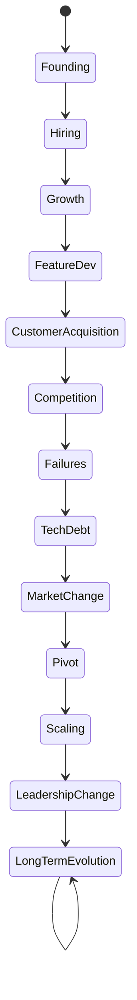
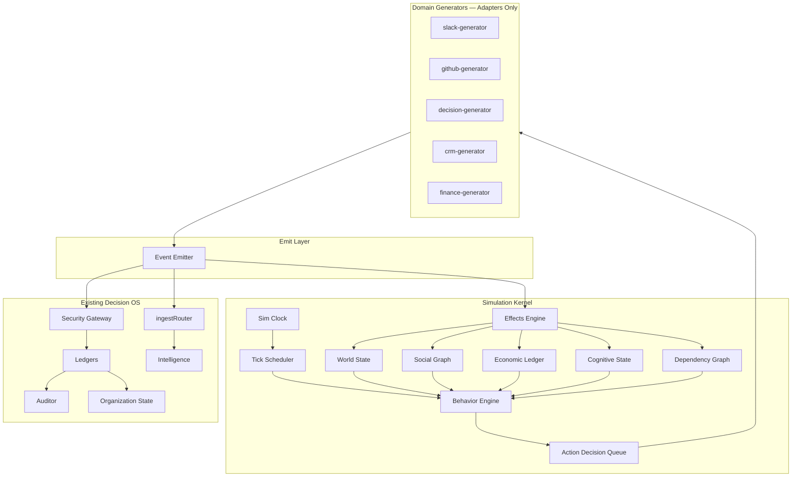
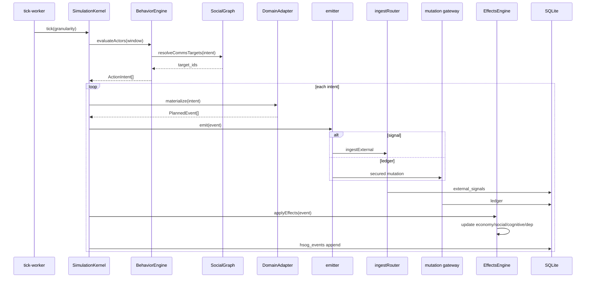

# Hustronix Synthetic Organization Generator (HSOG)

**Version:** 1.1 (Architecture + PRD — staff review revisions)  
**Date:** June 28, 2026  
**Status:** Phase 0 complete — ingest path landed (`apps/api/src/integrations/hsog`, `npm run hsog:ingest`). Full simulation kernel still future; smoke corpus from hsog `os_ingest.json` feeds the live Decision OS ledger.  
**Revision:** v1.1 adds Simulation Kernel, Behavior/Economic/Social/Cognitive engines, dependency network, canonical benchmarks, realism metrics, and implementation discipline gates.  
**Audience:** Staff engineers, architects, QA, product  
**Source of truth:** [`architecture-report-2026-06.md`](architecture-report-2026-06.md), live codebase (`apps/api`, `apps/web`)

---

## Table of contents

1. [Executive summary](#1-executive-summary)
2. [Architecture compatibility report](#2-architecture-compatibility-report-required-first)  
   - [2.8 Subsystem deep-dive](#28-subsystem-deep-dive-integration-contracts)  
   - [2.9 Bootstrap gap](#29-current-bootstrap-gap-why-hsog-is-needed)
3. [Product requirements (PRD)](#3-product-requirements-prd)
4. [System architecture](#4-system-architecture)  
   - [4.8 Simulation Kernel](#48-simulation-kernel-central-orchestrator)  
   - [4.9 Behavior Engine](#49-behavior-engine)  
   - [4.10 Economic Engine](#410-economic-engine)  
   - [4.11 Social Graph Engine](#411-social-graph-engine)  
   - [4.12 Cognitive Model](#412-cognitive-model)  
   - [4.13 Project Dependency Network](#413-project-dependency-network)  
   - [4.14 Expanded World Model](#414-expanded-world-model)
5. [Event model](#5-event-model)
6. [Module design](#6-module-design)
7. [Database schema](#7-database-schema)
8. [API design](#8-api-design)
9. [UI design](#9-ui-design)
10. [Implementation roadmap](#10-implementation-roadmap)
11. [Testing strategy](#11-testing-strategy)
12. [Documentation deliverables](#12-documentation-deliverables)
13. [Deployment guide (summary)](#13-deployment-guide-summary)
14. [Extension guide (summary)](#14-extension-guide-summary)
15. [Canonical benchmark suites](#15-canonical-benchmark-suites)
16. [Simulation realism validation](#16-simulation-realism-validation)
17. [Implementation discipline](#17-implementation-discipline)

---

## 1. Executive summary

**HSOG** is a deterministic **behavior-driven** organization lifecycle simulator. It produces realistic, explainable organizational history by simulating *why people act*, *how money flows*, and *how relationships drive communication* — then emitting artifacts through the **existing Decision OS**.

| Property | HSOG | Anti-patterns rejected |
| --- | --- | --- |
| Purpose | Benchmark, demo, AI eval, Decision OS validation | Faker wrapper, random noise |
| Model | Behavior → action → event (not event → event) | Rate-based event spraying |
| Determinism | Seeded PRNG → reproducible timelines | `Math.random()` without seed |
| Causality | Every event has actor, intent, preconditions, effects | Unexplained mutations |
| Integration | Emits through ingest + mutation gateway | Parallel shadow database |
| Orchestration | Single Simulation Kernel owns tick loop | Scattered generator orchestration |

**One-line rule (inherited from Decision OS):**

> Events compile into state; state informs reasoning; reasoning proposes actions; enforcement commits actions to the ledger.

**HSOG corollary:**

> People have goals; goals drive actions; actions produce events; events update world, social, economic, and cognitive state.

HSOG is an **upstream simulation platform** sitting beside integrations. Domain generators are **adapters** that translate kernel decisions into Decision OS artifacts.

---

## 2. Architecture compatibility report (required first)

### 2.1 Codebase analysis summary

Analysis covered: ledger, auditor, entity registry, organization state compiler, belief engine, causal simulator, reasoning router, agent framework, security gateway, ingest router, intelligence pipeline, digital twin, evaluation layer, temporal state, and deployment constraints.

| Subsystem | Location | Maturity | HSOG relationship |
| --- | --- | --- | --- |
| Decision ledger | `database.ts`, `decision-lifecycle.ts` | Production-ready | **Write target** — synthetic decisions via existing APIs/handlers |
| Execution ledger | `database.ts`, `mutation-handlers.ts` | Production-ready | **Write target** — tasks transition through normal paths |
| External signals | `integrations/ingestRouter.ts` | Production-ready | **Primary ingress** for Slack/GitHub/email/meeting sim events |
| Auditor | `auditor.ts` | Production-ready | **Must run** — validates enforcement under synthetic load |
| Entity registry | `entities/` | Implemented | **Reuse** — upsert entities as sim creates org structure |
| Organization state | `state/organization-state.ts` | Implemented | **Downstream projection** — auto-patches on ledger writes |
| Belief engine | `beliefs/belief-engine.ts` | Implemented | **Downstream** — beliefs from synthetic decision commits |
| Causal simulator | `simulation/causal-simulator.ts` | Implemented | **Complement** — decision what-if; HSOG drives timeline forward |
| Digital twin | `state/digital-twin.ts` | Implemented | **Observability** — metrics over synthetic ledger |
| Reasoning router | `reasoning/router.ts` | Implemented | **Eval target** — benchmark L0–L5 on synthetic orgs |
| Context builder | `state/context-builder.ts` | Implemented | **Eval target** — prompt context from synthetic state |
| Security gateway | `security/security-gateway.ts` | Implemented | **Respect** — sim mutations via dedicated principal + flags |
| Mutation handlers | `security/mutation-handlers.ts` | Implemented | **Reuse** for decision commit/transition |
| Intelligence pipeline | `intelligence/index.ts` | Implemented | **Runs on synthetic signals** — full detect/link/enrich path |
| Evaluation | `evaluation/outcome-evaluation.ts` | Implemented | **Reuse** when synthetic decisions complete |
| Temporal state | `state/temporal.ts` | Implemented | **Replay UI** — version diffs over sim history |
| Repository layer | `db/repository.ts` | Foundation only | **Future** — async Postgres cutover unchanged |
| Workers | In-process cron + OAuth workers | Partial | **Phase 1:** in-process queue; **Phase 6:** Container App Job |

### 2.2 Reusable modules (do not duplicate)

| Capability | Reuse via | Do not rebuild |
| --- | --- | --- |
| Signal normalization + dedup | `ingestExternal()` in `ingestRouter.ts` | Custom signal insert |
| Provider transforms | Pattern from `webhookTransforms.ts` | Per-channel DB writers |
| Entity upsert | `upsertEntityFromRef()` in `entities/store.ts` | Parallel entity tables |
| Graph edges | `evidence-graph.ts` — `upsertEvidenceNode`, `linkEvidence` | Separate graph DB |
| State compilation | `compileOrganizationState`, `patchOrganizationState` | Custom state JSON |
| Decision lifecycle | `mutationCreateDraftDecision`, `mutationCommitDecision` | Raw SQL on ledger |
| Execution transitions | `mutationTransitionExecution` | Direct status UPDATE |
| Belief promotion | `onDecisionCommitted` | Manual belief INSERT |
| Outcome loop | `evaluateDecisionOutcome` | Ad-hoc scoring |
| Search / FTS | `hybridSearch.ts` | Separate search index |
| Tenant provisioning | `provisionDefaultOrganization()` | Ad-hoc user rows |
| Team roster | `team_roster` table + `rosterImport.ts` | Fake employee CSV only |
| Deterministic hashing | Pattern from `causal-simulator.ts` `graphHash()` | Unhashed replay keys |
| Dynamic confidence | `computeDynamicConfidence()` | Hardcoded confidence |
| Simulation run persistence | Extend `simulation/schema.ts` | Unrelated `sim_runs` table |

### 2.3 Extension points

```text
┌─────────────────────────────────────────────────────────────────┐
│                     HSOG Simulation Kernel                       │
│  Time → Scheduler → Behavior → World/Social/Economic/Cognitive   │
│       → Action Queue → Effects → Domain Generators (adapters)    │
└────────────────────────────┬────────────────────────────────────┘
                             │ ingestExternal / mutation gateway
                             ▼
┌─────────────────────────────────────────────────────────────────┐
│              Existing Decision OS (unchanged semantics)          │
│  external_signals → intelligence → graph → auditor → ledger      │
│       → organization state → beliefs → digital twin              │
└────────────────────────────┬────────────────────────────────────┘
                             │ read APIs
                             ▼
┌─────────────────────────────────────────────────────────────────┐
│  HSOG dashboard (new UI) + existing Mission Control / Signals  │
└─────────────────────────────────────────────────────────────────┘
```

| Extension point | Mechanism | Notes |
| --- | --- | --- |
| **Synthetic tenant** | New `organizations` row with `metadata_json.origin = "hsog"` | Isolated `org_id`; never mix with production user org |
| **Signal ingest** | `ingestExternal({ provider: "hsog", ... })` | Add `HSOG` to `IngestSource` enum + schema CHECK migration |
| **Ledger writes** | `executeSecuredTool` / `mutation-handlers` with `authKind: "hsog_runner"` | New auth path: API key + `x-simulation-id` |
| **Auditor hook** | Existing `db.setLedgerAuditorHook` — no change | Synthetic events trigger same enforcement |
| **State patch** | Existing `onLedgerEventForState` debounce | Automatic |
| **Causal what-if** | Existing `POST /api/decisions/simulate` | HSOG UI links sim org decisions to causal runs |
| **Config-driven rules** | New `hsog/scenarios/*.yaml` + `hsog/rules/` | No hardcoded business logic in TS |
| **Worker queue** | `hsog/workers/tick-worker.ts` — in-process first | Same swap pattern as `ingestRouter` comment (BullMQ later) |
| **Export** | Snapshot tables + `pg_dump`-style JSON bundle | Read-only export of sim tenant scope |

### 2.4 Integration without breaking existing behavior

| Risk | Mitigation |
| --- | --- |
| Synthetic data pollutes real tenants | **Hard rule:** HSOG only writes to tenants where `organizations.metadata_json.simulation = true` |
| Auditor kills demo signals | Expected — sim scenarios include linking workflows; document grace windows in scenario DSL |
| ACTIVE decision conflict | Sim orgs use scenario-controlled commit timing; one ACTIVE enforced same as prod |
| Dual-control blocks sim commits | `HSOG_BYPASS_APPROVALS=1` env + `hsog_runner` role scoped to sim tenants only |
| `system` tenant collision | Deprecate bootstrap demo seed for eval; HSOG creates dedicated sim tenants |
| Performance on SQLite | Sim runs throttled by tick budget; long runs via worker queue; export offline |
| Security: sim API exposed | Route prefix `/api/hsog/*` gated by `HSOG_ENABLED=1` + admin role + separate API key |
| Causal simulator name clash | HSOG lives in `simulation/hsog/`; existing module stays `simulation/causal-simulator.ts` |

### 2.5 Assumptions

1. **SQLite remains runtime DB** until Phase 6 Postgres cutover; HSOG schema uses same `ensure*Schema` pattern as `simulation/schema.ts`.
2. **Synthetic orgs are disposable** — delete tenant cascades sim artifacts; no merge into production orgs.
3. **Determinism scope:** Same seed + same HSOG version + same Decision OS version → identical event sequence. LLM enrichment in intelligence pipeline may diverge unless `HSOG_DISABLE_LLM_ENRICH=1` (default for determinism tests).
4. **No LLM in core sim loop** — generators are rule + template + seeded PRNG (aligned with causal simulator philosophy).
5. **Minute-level ticks** are logical sim time, not real-time sleep — wall clock decoupled via `sim_clock`.
6. **Internal dashboard only** — not customer-facing; lives under `/simulation` route group.
7. **Entity types** remain the v2 set; HSOG maps vendors/investors/products to existing types + `metadata_json` subtypes until entity model extends.
8. **Horizontal scale deferred** — single replica + in-process workers acceptable for v1.

### 2.6 Architectural tensions (inherited)

From [`architecture-report-2026-06.md`](architecture-report-2026-06.md) §13 — HSOG must not worsen:

| Tension | HSOG stance |
| --- | --- |
| `user_id` vs `org_id` | Sim tenants use full `org_id` scoping from day one |
| Agent-as-controller | HSOG never bypasses mutation gateway for "speed" |
| Chat vs state memory | Sim chat optional; ledger + signals are canonical |

### 2.7 Compatibility verdict

**HSOG is compatible** with the Decision OS architecture when implemented as an **upstream behavior-driven simulation platform** that feeds existing ingest and mutation paths. The codebase already contains ~80% of the **downstream** machinery HSOG needs to validate; the gap is **upstream lifecycle simulation** (kernel + cognitive engines), not duplicate ledger/state systems.

v1.1 adds the **Simulation Kernel** and **Behavior/Economic/Social/Cognitive engines** required to cross from "event-generation framework" to "organization simulation platform" without breaking Decision OS semantics.

**Do not begin implementation** until Phase 0 acceptance criteria (§10) are signed off on v1.1.

### 2.8 Subsystem deep-dive (integration contracts)

Each subsystem below was traced in source. HSOG must **call into** these modules — never fork parallel implementations.

#### Decision Ledger

| Attribute | Detail |
| --- | --- |
| **Module** | `apps/api/src/database.ts`, `security/decision-lifecycle.ts` |
| **Tables** | `decision_ledger`, `decision_audit_log`, `decision_outcomes` |
| **Write path** | `saveDecisionEvent` → DRAFT; `transitionDecisionState` → ACTIVE/COMPLETED/REVERSED |
| **HSOG use** | `decision-generator` calls `mutationCreateDraftDecision` + `mutationCommitDecision` with institutional v3 payloads |
| **Constraint** | One ACTIVE decision per `org_id` — scenario DSL must serialize strategic commits |

#### Execution Ledger

| Attribute | Detail |
| --- | --- |
| **Module** | `database.ts`, `security/mutation-handlers.ts` |
| **Tables** | `execution_ledger` |
| **Write path** | Tasks created on ACTIVE commit; `mutationTransitionExecution` for state changes |
| **HSOG use** | `execution-generator` + `task-generator` drive realistic stall/block/DONE arcs to exercise auditor rules |
| **Constraint** | Owner strings must match `team_roster` / entity refs for digital twin accuracy |

#### Organization State

| Attribute | Detail |
| --- | --- |
| **Module** | `state/organization-state.ts`, `state/versioning.ts` |
| **Tables** | `organization_state_versions` |
| **Update path** | `onLedgerEventForState` (500ms debounce) + nightly `rebuildOrganizationState` cron |
| **HSOG use** | `organization-state-sync` verifies compile lag; UI uses `GET /api/state/current` and `getStateAt()` from `state/temporal.ts` |
| **Constraint** | Sim clock timestamps on signals/decisions affect temporal queries — emit with logical `sim_time` |

#### Company Brain (Entity Registry)

| Attribute | Detail |
| --- | --- |
| **Module** | `entities/store.ts`, `entities/schema.ts` |
| **Tables** | `entities`, `entity_embeddings` |
| **Write path** | `upsertEntityFromRef({ tenantId, type, refId, label, metadata_json })` |
| **HSOG use** | All structural generators (company, person, team, customer, project) upsert entities first, then attach signals |
| **Constraint** | 12 v2 entity types; vendors/investors use `metadata_json.subtype` until model extends |

#### Belief Engine

| Attribute | Detail |
| --- | --- |
| **Module** | `beliefs/belief-engine.ts` |
| **Tables** | `beliefs`, `belief_evidence` |
| **Write path** | `onDecisionCommitted` promotes `ranked_hypotheses`; `applyEvidence` on outcomes |
| **HSOG use** | `belief-generator` schedules hypothesis-bearing decisions; competitor/market signals feed refutation arcs |
| **Constraint** | Beliefs emerge from real commits — do not INSERT beliefs directly except via engine APIs |

#### Causal Simulator (existing — not HSOG)

| Attribute | Detail |
| --- | --- |
| **Module** | `simulation/causal-simulator.ts` |
| **Tables** | `simulation_runs` |
| **API** | `POST /api/decisions/simulate` |
| **HSOG use** | Dashboard links DRAFT decisions to what-if cards; HSOG timeline drives graph that simulator reads |
| **Constraint** | Separate table namespace (`simulation_runs` vs `hsog_runs`) — no merge |

#### Reasoning Router + Context Builder

| Attribute | Detail |
| --- | --- |
| **Modules** | `reasoning/router.ts`, `reasoning/cost-optimizer.ts`, `state/context-builder.ts` |
| **HSOG use** | `evaluation/ground-truth.ts` generates Q&A pairs; benchmark harness runs router against synthetic orgs |
| **Constraint** | L0–L5 eval requires populated ledger + state — HSOG is the dataset factory |

#### Agent Framework

| Attribute | Detail |
| --- | --- |
| **Modules** | `agent.ts`, `assistant-agent.ts`, `security/security-gateway.ts` |
| **HSOG use** | Optional agent eval mode (Phase 6+): agent operates on sim tenant with known ground truth |
| **Constraint** | All tool calls via `executeSecuredTool` — HSOG never invokes `db.*` directly for ledger writes |

#### Auditor

| Attribute | Detail |
| --- | --- |
| **Module** | `auditor.ts` |
| **Trigger** | `db.setLedgerAuditorHook` in `bootstrap.ts` — runs on every ledger write + 5m cron |
| **HSOG use** | Scenarios must include linking workflows or auditor will KILL unlinked signals after grace |
| **Constraint** | Shadow work detection is a **feature** for HSOG regression tests, not a bug |

#### Mutation Gateway

| Attribute | Detail |
| --- | --- |
| **Module** | `security/security-gateway.ts`, `security/mutation-handlers.ts` |
| **HSOG use** | `emitter.ts` routes ledger actions through same handlers as REST/WS |
| **Constraint** | Dual-control bypass only via `HSOG_BYPASS_APPROVALS=1` + sim tenant guard |

#### Security Layer

| Attribute | Detail |
| --- | --- |
| **Modules** | `middleware/auth.ts`, `security/authorization.ts`, `security/tenant-scope.ts` |
| **HSOG use** | New `authKind: "hsog_runner"`; `assertSimulationTenant(orgId)` on every handler |
| **Constraint** | Sim tenants flagged in `organizations.metadata_json` — never write to production orgs |

#### Event Pipeline (Intelligence)

| Attribute | Detail |
| --- | --- |
| **Module** | `intelligence/index.ts` |
| **Flow** | ingest → content trust → detect → enrich → link policy → graph → state patch |
| **HSOG use** | All channel generators emit via `ingestExternal({ provider: "hsog", ... })` |
| **Constraint** | Add `HSOG` to `IngestSource` enum; map `provider: "hsog"` → bucket `HSOG` in `ingestRouter.ts` |

#### Integrations

| Attribute | Detail |
| --- | --- |
| **Module** | `integrations/ingestRouter.ts`, `integrations/webhookTransforms.ts` |
| **HSOG use** | HSOG replaces OAuth webhooks for sim tenants only; reuse transform patterns for payload shape |
| **Constraint** | `externalId` must be deterministic (`hsog:{run_id}:{seq}`) for idempotent replay |

#### Search

| Attribute | Detail |
| --- | --- |
| **Module** | `intelligence/hybridSearch.ts` |
| **HSOG use** | `GET /api/hsog/search` delegates to hybrid search scoped by sim `org_id` |
| **Constraint** | FTS backfill runs on startup (`bootstrap.ts`) — sim ingest populates mirrors automatically |

#### State Compiler + Temporal

| Attribute | Detail |
| --- | --- |
| **Modules** | `state/organization-state.ts`, `state/temporal.ts` |
| **HSOG use** | Timeline UI uses `getStateAt(orgId, simTime)` and `getEntityTimelineForTenant` |
| **Constraint** | Version snapshots compile at wall time — for historical scrub, prefer `hsog_events` + ledger replay |

#### Digital Twin

| Attribute | Detail |
| --- | --- |
| **Module** | `state/digital-twin.ts` |
| **HSOG use** | Metrics dashboard; twin computed from real ledger rows (morale, velocity, focus, etc.) |
| **Constraint** | Twin reflects sim activity only if execution transitions and signals are realistic |

#### Evaluation Layer

| Attribute | Detail |
| --- | --- |
| **Module** | `evaluation/outcome-evaluation.ts` |
| **HSOG use** | When sim decisions reach COMPLETED, `evaluateDecisionOutcome` runs — validates learning loop |
| **Constraint** | Expected outcomes in decision payloads must align with `finance-generator` metric drift |

### 2.9 Current bootstrap gap (why HSOG is needed)

`bootstrap.ts` seeds only when `execution_ledger` is empty:

- 1 DRAFT/ACTIVE decision ("Optimize Conversion for Series B Landing Page")
- 2 static signals (Slack + GitHub)
- No org chart, lifecycle, branching, or reproducibility

HSOG replaces ad-hoc demo seeding with **seeded, scenario-driven tenants** that never touch the `system` user's default org unless explicitly configured.

---

## 3. Product requirements (PRD)

### 3.1 Problem statement

Hustronix needs realistic, evolving organizations to:

- Benchmark reasoning router and intelligence pipeline under load
- Demo Decision OS without manual data entry
- Evaluate agent tool use against known ground truth
- Regression-test auditor, state compiler, and belief promotion
- Train/evaluate models on structured organizational timelines

Current bootstrap seed (`bootstrap.ts`) creates one static decision and two signals — insufficient for lifecycle, causality, or replay testing.

### 3.2 Goals

| ID | Goal | Success metric |
| --- | --- | --- |
| G1 | Deterministic org generation from seed | 100% replay match on determinism test suite |
| G2 | Continuous time evolution | 30-day sim completes < 10 min (configurable tick budget) |
| G3 | Full Decision OS integration | Sim org passes auditor + state compile + hybrid search |
| G4 | Explainable events | 100% events have `intent`, `preconditions`, `effects` in sim metadata |
| G5 | Branching timelines | Fork from snapshot produces divergent but reproducible branch |
| G6 | Benchmark datasets | Export preset scenarios (startup, scale-up, pivot, incident) |
| G7 | Behavioral realism | ≥90% of comms events trace to social graph edge + actor goal |
| G8 | Economic emergence | MRR/runway derived from contracts/payments, not metric drift alone |
| G9 | Realism validation | Canonical benchmarks pass defined topology and distribution gates |

### 3.3 Non-goals (v1)

- Replacing real integrations (Slack/GitHub OAuth)
- LLM-generated organizational narratives in the hot path
- Multi-tenant sim orchestration at cloud scale (v1: ≤10 concurrent sims)
- Customer self-service sim creation
- Postgres-only features before cutover

### 3.4 Personas

| Persona | Need |
| --- | --- |
| **Platform engineer** | Replay tests, load tests, CI determinism gates |
| **Product demo** | One-click "Series B SaaS" org with 6 months history |
| **AI eval engineer** | Ground-truth Q&A pairs from sim timeline |
| **Security reviewer** | Proof that sim tenants cannot escape isolation |

### 3.5 Generated organization scope

Everything interacts through **entities**, **ledger**, and **signals**:

| Domain | v1 | v2 |
| --- | --- | --- |
| Company, departments, teams, employees | ✅ | |
| Contractors, customers, competitors | ✅ | |
| Investors, vendors | ✅ (as entity metadata) | full CRM objects |
| Products, features, projects, objectives | ✅ | |
| Metrics, documents | ✅ (metrics + memory facts) | doc store |
| Slack, meetings, emails, GitHub | ✅ via ingest | |
| CRM, marketing, recruiting, sales, finance | ✅ (signal templates) | dedicated generators |
| Decisions, tasks, risks, incidents | ✅ | |
| Experiments, roadmaps | | ✅ |

### 3.6 Organization lifecycle (scenario-driven)



Lifecycle phases are **configuration**, not code branches. Each phase defines:

- Actors enabled
- Event rate curves
- Decision templates
- Metric drift parameters
- World event probabilities (deterministic from seed)

### 3.7 Functional requirements

#### Simulation control

| ID | Requirement |
| --- | --- |
| FR-1 | Create organization from seed + scenario preset |
| FR-2 | Start / pause / resume / reset simulation |
| FR-3 | Advance sim clock by tick granularity |
| FR-4 | Fork simulation from snapshot |
| FR-5 | Import / export simulation bundle |
| FR-6 | Search events and entities within sim tenant |

#### Event quality

| ID | Requirement |
| --- | --- |
| FR-10 | Every event records causal links to prior sim events |
| FR-11 | Failed preconditions skip event (logged, not thrown) |
| FR-12 | Origin tag `hsog:<generator>:<rule_id>` on all artifacts |

#### Observability

| ID | Requirement |
| --- | --- |
| FR-20 | Live event stream (WebSocket or SSE) |
| FR-21 | Organization state explorer at any sim timestamp |
| FR-22 | Decision + execution history views |
| FR-23 | Digital twin metrics over sim time |

### 3.8 Non-functional requirements

| ID | Requirement | Target |
| --- | --- | --- |
| NFR-1 | Deterministic replay | Bit-identical event log for fixed seed |
| NFR-2 | Tick throughput | ≥1000 events/min (in-process, SQLite) |
| NFR-3 | Tenant isolation | Zero cross-tenant reads in red-team test |
| NFR-4 | Configurability | Scenario change without TS redeploy |
| NFR-5 | Auditability | All sim control actions in `security_events_v8` |
| NFR-6 | Behavioral coherence | Actions must resolve from actor state (goals, stress, availability) |
| NFR-7 | File size discipline | No file >500 lines without ADR justification |

### 3.9 Behavior-driven simulation (design principle)

HSOG is **not** an event generator. Events are **outputs** of an internal simulation stack:

```text
People (actors)
    ↓
Goals + Needs + Beliefs (per-actor + org cognitive state)
    ↓
Memory (short-term workload, long-term institutional)
    ↓
Decision making (Behavior Engine — deterministic utility scoring)
    ↓
Actions (work, communicate, approve, hire, escalate)
    ↓
Domain generators (adapters: Slack, GitHub, ledger, CRM, …)
    ↓
Decision OS ledger + signals
    ↓
Effects Engine (updates economic, social, cognitive, dependency state)
```

Every employee actor carries persistent state:

| Dimension | Purpose |
| --- | --- |
| **Motivations** | Career growth, stability, impact, compensation |
| **Work habits** | Deep-work blocks, meeting tolerance, async preference |
| **Relationships** | Manager, reports, allies, rivals (Social Graph) |
| **Priorities** | Current OKR weight, interrupt sensitivity |
| **Stress / load** | Drives delays, conflicts, burnout arcs |
| **Political alignment** | Strategy support, faction membership |
| **Competence** | Task success probability, review quality |
| **Learning** | Skill growth affects velocity over sim time |
| **Availability** | PTO, sick, part-time, timezone |
| **Preferences** | Channel choice (Slack vs email), escalation style |

Without this layer, HSOG would produce statistically plausible but **behaviorally hollow** organizations. The Behavior Engine is a **Phase 2 gate** — not deferred to v2.

---

## 4. System architecture

### 4.1 Layer placement

HSOG sits **beside** integrations, not inside the reasoning layer. All simulation logic flows through the **Simulation Kernel**:



### 4.2 Folder structure

```text
apps/api/src/simulation/
├── causal-simulator.ts          # EXISTING — decision what-if
├── schema.ts                    # EXISTING — extend for hsog tables
└── hsog/
    ├── index.ts                 # Public facade + composition root
    ├── schema.ts                # HSOG SQLite tables + migrations/
    ├── types.ts                 # Shared types (documented exports)
    ├── rng.ts                   # Seeded PRNG
    ├── clock.ts                 # Sim clock
    ├── snapshot.ts              # Snapshot / restore / fork
    ├── scenario-loader.ts       # YAML/JSON scenario DSL
    ├── event-model.ts           # SimEvent envelope
    ├── emitter.ts               # Routes to ingest + mutations (only I/O exit)
    │
    ├── kernel/                  # ★ Central orchestrator — all ticks flow here
    │   ├── simulation-kernel.ts # Single entry: tick(), plan(), applyEffects()
    │   ├── tick-scheduler.ts    # Granularity + window scheduling
    │   ├── action-queue.ts      # Priority queue of pending actions
    │   └── effects-engine.ts    # Post-emit state mutations
    │
    ├── engines/                 # ★ Cognitive / behavioral subsystems
    │   ├── behavior-engine.ts   # Actor goals → action selection
    │   ├── economic-engine.ts   # Contracts → cash flow → runway
    │   ├── social-graph.ts      # Relationships → comms routing
    │   ├── cognitive-model.ts   # Institutional memory, trust, fatigue
    │   ├── dependency-graph.ts  # Project/task dependency DAG
    │   └── world-model.ts       # Macro economy, labor market, regulation
    │
    ├── adapters/                # Domain generators (thin — no business logic)
    │   ├── company-generator/
    │   ├── person-generator/
    │   ├── team-generator/
    │   ├── project-generator/
    │   ├── task-generator/
    │   ├── slack-generator/
    │   ├── meeting-generator/
    │   ├── email-generator/
    │   ├── github-generator/
    │   ├── crm-generator/
    │   ├── sales-generator/
    │   ├── customer-generator/
    │   ├── competitor-generator/
    │   ├── finance-generator/
    │   ├── decision-generator/
    │   ├── execution-generator/
    │   ├── knowledge-generator/
    │   └── belief-generator/
    │
    ├── organization-state-sync.ts
    ├── evaluation/
    │   ├── benchmarks.ts        # Canonical suite runners
    │   ├── ground-truth.ts
    │   └── realism-metrics.ts   # Topology + distribution validators
    ├── export/
    ├── api/routes.ts
    └── workers/tick-worker.ts   # Delegates to kernel.tick()

config/hsog/
├── scenarios/                   # YAML presets
├── benchmarks/                  # Canonical suite definitions
├── rules/                       # Behavior + economic rule configs
└── scenario.schema.json

docs/adr/hsog/                   # ADR per major decision (required)
ops/scripts/hsog/
├── determinism.test.ts
├── replay.test.ts
├── realism.test.ts              # Benchmark distribution gates
└── load.test.ts
```

### 4.3 Dependency injection pattern

```typescript
// hsog/index.ts — composition root
export interface HsogDependencies {
  ingest: typeof ingestExternal;
  mutations: {
    createDraft: typeof mutationCreateDraftDecision;
    commit: typeof mutationCommitDecision;
    transition: typeof mutationTransitionExecution;
  };
  entities: { upsert: typeof upsertEntityFromRef };
  graph: { link: typeof linkEvidence };
  db: typeof db;
  clock: SimClock;
  rng: SeededRng;
}
```

Generators receive `HsogContext` (deps + sim run + tenant + clock + rng) — no global singletons in business logic.

### 4.4 Determinism design

```text
master_seed
  ├─ stream "org"     → company name, founding date, industry
  ├─ stream "people"  → employee personas
  ├─ stream "world"   → market events
  ├─ stream "slack"   → message templates + timing
  └─ stream "decisions" → strategic decision sequence
```

- **PRNG:** Mulberry32 with stream derivation `hash(master_seed + stream_name)`
- **Snapshot hash:** SHA-256 over ordered event log + sim clock + schema version
- **Replay:** Disable wall-clock; inject events with historical `detectedAt`
- **Branch:** New run_id, parent_run_id, fork_at_event_seq; branch seed = `hash(parent_seed + fork_at)`

### 4.5 Security model

| Principal | Scope | Permissions |
| --- | --- | --- |
| `hsog_runner` (API key) | Sim tenants only | Create sim, tick, export |
| Admin user | UI control | All `/api/hsog/*` |
| Normal user | None | No access |

Sim mutations use `authKind: "hsog_runner"` with `assertSimulationTenant(orgId)` guard in every handler.

### 4.6 SimWorldState (in-memory + snapshot)

Persistent simulation state separate from Decision OS projections:

```typescript
interface SimWorldState {
  run_id: string;
  phase: LifecyclePhase;
  phase_entered_at: string;
  schema_version: number;
  rng_offsets: Record<string, number>;

  // Engine-owned slices (serialized together in snapshots)
  actors: ActorState[];              // Behavior Engine
  social: SocialGraphState;          // Social Graph Engine
  economy: EconomicState;            // Economic Engine
  cognitive: CognitiveState;         // Cognitive Model
  dependencies: DependencyGraphState;// Project Dependency Network
  world: WorldModelState;            // Expanded World Model

  // Derived summary metrics (computed, not authored)
  metrics: DerivedMetrics;           // mrr, runway, headcount — from economy engine
}
```

- Each engine owns its slice; **Effects Engine** is the only writer after tick processing
- Serialized to `hsog_snapshots.world_state_json` at checkpoint intervals
- **Not** a substitute for Organization State — it drives *why* actors act next

### 4.7 Tick granularity and scheduling

| Granularity | Sim advance | Typical use |
| --- | --- | --- |
| `minute` | +1 minute | Incident bursts, standup Slack |
| `hour` | +1 hour | PR activity, email threads |
| `day` | +1 day | Default — hiring, task transitions |
| `week` | +7 days | Sprint boundaries, metrics |
| `month` | +30 days | Financial close, board updates |
| `quarter` | +91 days | Strategic decisions, pivots |
| `year` | +365 days | Long-term evolution benchmarks |

**Kernel tick algorithm** (replaces scattered generator orchestration):

1. `SimulationKernel.tick(runId, granularity)` — single public entry
2. **Scheduler** computes `[windowStart, windowEnd)` from sim clock
3. **Behavior Engine** evaluates each available actor: goals × world × social × stress → ranked `ActionIntent[]`
4. **Action Queue** merges intents; resolves conflicts (same actor, same window) deterministically by `(priority, rule_id, seq)`
5. For each intent: matching **adapter** (`slack-generator`, etc.) materializes `PlannedEvent[]` — adapters do **not** decide *whether* to act
6. Preconditions evaluated; **Emitter** writes to Decision OS
7. **Effects Engine** applies action effects to economy, social, cognitive, dependency, world slices
8. Advance sim clock; append `hsog_events`; checkpoint snapshot every N events

**Indefinite run:** Worker calls `kernel.tick()` while `status === RUNNING`; pause halts scheduler only.

### 4.8 Simulation Kernel (central orchestrator)

The kernel is the **only** module allowed to advance simulation time. Generators never call each other; they never emit directly without kernel dispatch.

```typescript
/** Documented public interface — see hsog/kernel/simulation-kernel.ts */
export interface SimulationKernel {
  /** Advance one time window. Returns events emitted this tick. */
  tick(ctx: KernelContext, granularity: TickGranularity): TickResult;

  /** Plan without emitting — used by replay validation. */
  dryRun(ctx: KernelContext, granularity: TickGranularity): PlannedEvent[];

  /** Restore from snapshot at seq. */
  restore(runId: string, atSeq: number): KernelContext;

  /** Fork to new run_id with optional seed mutation. */
  fork(runId: string, atSeq: number, newSeed?: string): string;
}

export interface KernelContext {
  run: SimRun;
  clock: SimClock;
  rng: SeededRng;
  world: SimWorldState;
  scenario: LoadedScenario;
  deps: HsogDependencies;
}
```

**Dependency rule:** `kernel/` may import `engines/` and `adapters/`; `engines/` may not import `adapters/`; `adapters/` may not import `kernel/`. No circular imports.

### 4.9 Behavior Engine

Deterministic actor decision-making. No LLM. Each tick, for each available actor:

```text
perceived_state = f(world, social, cognitive, workload, dependencies)
utility(action) = Σ weighted_factors(goals, habits, relationships, stress, alignment)
selected_action = argmax utility(actions_feasible)  // tie-break: rng stream "behavior:{actor_id}"
```

**Action types** (internal, not yet events):

| Action | Typical adapter |
| --- | --- |
| `communicate` | slack-generator, email-generator |
| `meet` | meeting-generator |
| `commit_code` | github-generator |
| `advance_task` | execution-generator |
| `propose_decision` | decision-generator |
| `hire` / `escalate` / `delegate` | person-generator, task-generator |

**Config:** `config/hsog/rules/behavior/*.yaml` — goal weights by role, stress curves, competence growth rates.

**Integration with Hustronix Belief Engine:** Actor `beliefs[]` are sim-local priors; when decisions commit, downstream `beliefs/belief-engine.ts` promotes institutional beliefs from ledger — both layers coexist.

### 4.10 Economic Engine

Money is **not** a drifting metric. Financial outcomes **emerge** from transactions:

```text
Customers
    ↓
Contracts (term, ACV, seats, start_date)
    ↓
Invoices / Payments (scheduled, delayed, failed)
    ↓
Cash balance + ARR/MRR (derived)
    ↓
Burn (payroll + vendor + infra from economic state)
    ↓
Runway (derived)
    ↓
Behavior Engine inputs (hiring freeze, layoff pressure, fundraise urgency)
    ↓
Strategy decisions (via behavior → decision-generator)
```

**Core types:**

```typescript
interface EconomicState {
  cash_balance: number;
  contracts: SimContract[];
  payment_schedule: SimPayment[];
  payroll: SimPayrollEntry[];
  vendors: SimVendorBill[];
  funding_rounds: SimFundingRound[];
  derived: { mrr: number; arr: number; burn_monthly: number; runway_months: number };
}
```

**finance-generator** adapter emits memory facts + CRM signals **from** economic state changes (e.g. "Enterprise deal closed — $120k ACV"), never the other way around.

Churn is modeled as contract non-renewal with causal preconditions (competitor pressure, support incidents, champion departure via Social Graph).

### 4.11 Social Graph Engine

Communication emerges from relationships — Slack is never random spray.

**Edge types:** `reports_to`, `peer`, `cross_functional`, `mentor`, `rival`, `customer_champion`, `investor_board`

**Comms routing algorithm:**

1. Behavior Engine selects `communicate` with intent (status, blocker, gossip, escalate)
2. Social Graph returns candidate recipients weighted by: hierarchy distance, project overlap, friendship, recent conflict, urgency
3. Channel selection from actor `preferences` + org norms in scenario config
4. slack-generator / email-generator render templates with dyadic context

```typescript
interface SocialGraphState {
  nodes: string[];  // actor_ids
  edges: SocialEdge[];
  channels: SimChannel[];  // #eng, #sales, DM threads
  comms_density_7d: number;  // derived — realism metric input
}
```

**Political alignment** and **conflict** edges drive meeting frequency, decision opposition signals, and belief refutation arcs.

### 4.12 Cognitive Model

Organization-level and actor-level memory that accumulates over long simulations:

| Construct | Behavior |
| --- | --- |
| **Institutional memory** | Facts promoted to `memory_records` via knowledge-generator; decay rate configurable |
| **Knowledge decay** | Unused facts lose confidence in sim cognitive state (mirrors `computeDynamicConfidence` decay) |
| **Rumors** | Unverified beliefs with low confidence — may appear in Slack before verification |
| **Politics** | Faction alignment affects decision support scores |
| **Trust** | Manager-report trust modulates delegation vs micromanagement |
| **Reputation** | Owner reputation (`owner_reputation` table) fed by delivery outcomes |
| **Decision fatigue** | Recent decision count reduces actor approval speed |

```typescript
interface CognitiveState {
  institutional_facts: CognitiveFact[];
  rumors: CognitiveFact[];
  factions: Faction[];
  trust_matrix: Record<string, Record<string, number>>;
  decision_fatigue: Record<string, number>;
}
```

**Reuse:** Where possible, emit through existing `remember-fact` and Belief Engine paths so Decision OS and sim cognitive state stay aligned.

### 4.13 Project Dependency Network

Projects form a **DAG** (with explicit exception rules for justified cycles). Blockers emerge from structure, not random number generation.

**Dependency kinds:**

| Kind | Example |
| --- | --- |
| `depends_on_person` | Needs security review from Alice |
| `depends_on_project` | Mobile app blocked on API v2 |
| `depends_on_knowledge` | Requires compliance doc |
| `depends_on_approval` | Legal sign-off pending |
| `depends_on_external` | Vendor API not ready |
| `risk_materialized` | Incident opened dependency edge |

```typescript
interface DependencyGraphState {
  projects: SimProject[];
  edges: DependencyEdge[];
  critical_path: string[];  // recomputed each tick
  blocked_tasks: BlockedTaskRef[];
}
```

When Behavior Engine selects `advance_task`, Effects Engine checks dependency satisfaction. Unsatisfied → task stays BLOCKED → execution-generator emits transition → auditor and digital twin react realistically.

### 4.14 Expanded World Model

Replaces thin `world-generator` with a structured external environment the org **reacts to**:

| Domain | Influences |
| --- | --- |
| **Economy** | Macro growth, interest rates, VC appetite |
| **Investors** | Funding climate, board pressure events |
| **Labor market** | Time-to-hire, salary benchmarks, talent poaching |
| **Competitors** | Feature launches, pricing moves, win/loss |
| **Technology** | Platform shifts (e.g. AI wave), toolchain obsolescence |
| **Regulation** | Compliance deadlines, audit requirements |
| **News / social** | Brand events, PR crises |
| **Supply chain** | Vendor delays (optional, manufacturing scenarios) |

```typescript
interface WorldModelState {
  macro: MacroEconomy;
  labor_market: LaborMarket;
  competitors: CompetitorAgent[];
  regulatory: RegulatoryEvent[];
  news_queue: WorldNewsEvent[];
}
```

World events enter the kernel as **exogenous ActionIntents** (priority above normal actor actions unless scenario overrides). Behavior Engine re-evaluates actor goals after world shocks (pivot pressure, hiring freeze, incident mode).

---

## 5. Event model

### 5.1 SimEvent envelope

Every HSOG artifact wraps metadata:

```typescript
interface SimEvent {
  id: string;
  run_id: string;
  seq: number;                    // monotonic per run
  sim_time: string;               // ISO — logical clock
  wall_time?: string;             // optional real time for ops
  actor: { type: string; id: string; label: string };
  entity: { type: EntityType; id: string; label: string };
  intent: string;                 // human-readable "why now"
  action: string;                 // e.g. "signal.ingest", "decision.commit"
  preconditions: PreconditionResult[];
  effects: EffectRecord[];
  confidence: number;
  causal_links: { prior_seq: number; relation: string }[];
  origin: string;                 // hsog:slack-generator:rule/standup-001
  payload: Record<string, unknown>;
}
```

### 5.2 Precondition evaluation

Preconditions are declarative in scenario YAML:

```yaml
preconditions:
  - type: phase_is
    value: Growth
  - type: entity_exists
    entity_type: team
    label_pattern: "Engineering"
  - type: metric_below
    metric: churn_rate
    threshold: 0.08
```

Failed preconditions → event skipped, `sim_precondition_log` row written (deterministic).

### 5.3 Effect propagation

Effects feed the next tick's world state (in-memory `SimWorldState`, persisted per snapshot):

- Metric deltas
- Relationship graph updates
- Phase transitions
- Actor availability (PTO, quit, hire)

### 5.4 Scenario DSL (YAML)

Scenarios live in `config/hsog/scenarios/`. Loaded by `scenario-loader.ts` — no TS redeploy for new presets.

```yaml
# config/hsog/scenarios/startup-saas.yaml
id: startup-saas
version: 1
description: Seed-stage B2B SaaS from founding through Series A

founding:
  company_name_stream: org
  industry: b2b_saas
  founding_sim_date: "2024-01-15T09:00:00Z"
  initial_runway_months: 18

lifecycle:
  - phase: Founding
    duration_days: 30
    generators: [company-generator, person-generator, team-generator]
  - phase: Hiring
    duration_days: 90
    generators: [person-generator, team-generator, slack-generator]
  - phase: Growth
    duration_days: 180
    generators: [project-generator, github-generator, decision-generator, execution-generator]
  - phase: CustomerAcquisition
    duration_days: 120
    generators: [customer-generator, crm-generator, sales-generator, meeting-generator]
  - phase: Competition
    duration_days: 60
    generators: [competitor-generator, belief-generator, decision-generator]

generators:
  slack-generator:
    rules:
      - id: standup-001
        rate_per_day: 1.2
        channels: ["#engineering", "#general"]
        preconditions:
          - type: phase_in
            values: [Hiring, Growth, CustomerAcquisition]
      - id: incident-thread-001
        rate_per_day: 0.05
        preconditions:
          - type: metric_above
            metric: incident_pressure
            threshold: 0.3

  decision-generator:
    rules:
      - id: plg-vs-enterprise-001
        phase: Growth
        template: institutional_v3
        vow: "We choose Enterprise Sales over Self-Serve PLG"
        preconditions:
          - type: metric_above
            metric: mrr
            threshold: 50000
        causal_links: [prior_rule: standup-001]

metrics:
  initial:
    cash_balance: 500000
    headcount: 2
    churn_rate: 0
  # Economic engine derives mrr/runway — do not use drift-only finance
  economy:
    payroll_burn_per_head: 12000
    default_contract_acv: 24000
    payment_terms_days: 30

behavior:
  default_goal_weights:
    ic_engineer: { impact: 0.3, learning: 0.25, stability: 0.2, compensation: 0.15, politics: 0.1 }
  stress_threshold_escalate: 0.75

doctrine:
  - rule: "Never compete on price alone"
    priority: constitutional

tick:
  default_granularity: day
  events_per_tick_budget: 50
  snapshot_every_n_events: 100
```

**DSL validation:** JSON Schema at `config/hsog/scenario.schema.json` (Phase 2).

---

## 6. Module design

**Architecture split:**

| Layer | Responsibility | May emit to Decision OS? |
| --- | --- | --- |
| **Kernel** | Time, scheduling, dispatch | No |
| **Engines** | State evolution, actor decisions | No |
| **Adapters** | Materialize actions as signals/ledger writes | Yes, via `emitter.ts` only |
| **Emitter** | Single I/O boundary | Yes |

### 6.0 Core interfaces

```typescript
/** Behavior Engine — selects actions; does not emit. */
export interface BehaviorEngine {
  evaluateActors(ctx: KernelContext, window: TimeWindow): ActionIntent[];
}

/** Domain adapter — materializes intents as planned events; does not decide. */
export interface DomainAdapter {
  readonly id: string;
  supports(action: ActionType): boolean;
  materialize(ctx: KernelContext, intent: ActionIntent): PlannedEvent[];
}

/** Simulation Kernel — see §4.8 */
export interface SimulationKernel { /* ... */ }

export interface ActionIntent {
  actor_id: string;
  action: ActionType;
  intent: string;               // human-readable "why now"
  target_ids: string[];           // recipients, projects, etc.
  utility_score: number;
  preconditions: PreconditionSpec[];
  causal_links: CausalLink[];
  origin: string;                 // hsog:behavior-engine:goal/career-growth
}
```

Legacy `GeneratorModule.planEvents()` remains for **bootstrap-only** scenarios (Phase 1 empty tick) but is **deprecated by Phase 3** in favor of kernel dispatch.

| Module | Layer | Responsibility |
| --- | --- | --- |
| `kernel/simulation-kernel` | Kernel | Single tick entry, fork/restore |
| `kernel/tick-scheduler` | Kernel | Granularity windows |
| `kernel/action-queue` | Kernel | Conflict resolution |
| `kernel/effects-engine` | Kernel | Post-emit state updates |
| `engines/behavior-engine` | Engine | Goals → ActionIntents |
| `engines/economic-engine` | Engine | Contracts → cash → runway |
| `engines/social-graph` | Engine | Relationships → comms routing |
| `engines/cognitive-model` | Engine | Memory, trust, fatigue |
| `engines/dependency-graph` | Engine | Project DAG, blockers |
| `engines/world-model` | Engine | Exogenous shocks |
| `adapters/*-generator` | Adapter | Intent → SimEvent payloads |
| `emitter` | Emit | ingestExternal + mutation gateway |
| `evaluation/realism-metrics` | Eval | Distribution + topology gates |
| `organization-state-sync` | Observability | State compile lag checks |

---

## 7. Database schema

New tables via `ensureHsogSchema()` — separate from ledger tables.

```sql
-- Simulation runs
CREATE TABLE hsog_runs (
  id TEXT PRIMARY KEY,
  org_id TEXT NOT NULL,
  master_seed TEXT NOT NULL,
  scenario_id TEXT NOT NULL,
  parent_run_id TEXT,
  fork_at_seq INTEGER,
  status TEXT NOT NULL CHECK(status IN ('CREATED','RUNNING','PAUSED','COMPLETED','FAILED')),
  sim_clock TEXT NOT NULL,
  tick_granularity TEXT NOT NULL,
  config_json TEXT NOT NULL,
  schema_version INTEGER NOT NULL DEFAULT 1,
  created_at DATETIME DEFAULT CURRENT_TIMESTAMP,
  updated_at DATETIME DEFAULT CURRENT_TIMESTAMP
);

-- Append-only sim event log (canonical for replay)
CREATE TABLE hsog_events (
  id TEXT PRIMARY KEY,
  run_id TEXT NOT NULL,
  seq INTEGER NOT NULL,
  sim_time TEXT NOT NULL,
  event_json TEXT NOT NULL,
  UNIQUE(run_id, seq)
);

-- Snapshots for fork/restore
CREATE TABLE hsog_snapshots (
  id TEXT PRIMARY KEY,
  run_id TEXT NOT NULL,
  at_seq INTEGER NOT NULL,
  world_state_json TEXT NOT NULL,
  snapshot_hash TEXT NOT NULL,
  created_at DATETIME DEFAULT CURRENT_TIMESTAMP
);

-- Precondition skips (explainability)
CREATE TABLE hsog_precondition_log (
  id TEXT PRIMARY KEY,
  run_id TEXT NOT NULL,
  at_seq INTEGER,
  rule_id TEXT NOT NULL,
  reason TEXT NOT NULL,
  sim_time TEXT NOT NULL
);

-- Benchmark dataset registry
CREATE TABLE hsog_benchmarks (
  id TEXT PRIMARY KEY,
  name TEXT NOT NULL,
  scenario_id TEXT NOT NULL,
  seed TEXT NOT NULL,
  duration_sim_days INTEGER NOT NULL,
  export_path TEXT,
  realism_score_json TEXT,         -- v1.1: stored realism metric snapshot
  created_at DATETIME DEFAULT CURRENT_TIMESTAMP
);

-- Actor state persistence (optional checkpoint — primary in world_state_json)
CREATE TABLE hsog_actor_snapshots (
  id TEXT PRIMARY KEY,
  run_id TEXT NOT NULL,
  at_seq INTEGER NOT NULL,
  actor_id TEXT NOT NULL,
  state_json TEXT NOT NULL
);
```

**Existing table extensions:**

- `organizations.metadata_json` — add `{ "simulation": true, "hsog_run_id": "..." }`
- `external_signals` — allow source `HSOG` (schema migration)
- `simulation_runs` — keep for causal what-if; HSOG uses `hsog_runs`

---

## 8. API design

**Prefix:** `/api/hsog` (requires `HSOG_ENABLED=1`, admin or `hsog_runner` key)

| Method | Route | Description |
| --- | --- | --- |
| POST | `/organizations` | Create sim org `{ seed, scenarioId, name? }` |
| GET | `/organizations/:runId` | Run status + metadata |
| POST | `/runs/:runId/start` | Start tick worker |
| POST | `/runs/:runId/pause` | Pause |
| POST | `/runs/:runId/resume` | Resume |
| POST | `/runs/:runId/advance` | `{ ticks, granularity }` |
| POST | `/runs/:runId/reset` | Reset to seq 0 (destructive) |
| POST | `/runs/:runId/fork` | `{ atSeq?, newSeed? }` |
| GET | `/runs/:runId/events` | Paginated event log |
| GET | `/runs/:runId/events/:seq` | Event inspector |
| GET | `/runs/:runId/timeline` | Aggregated timeline |
| GET | `/runs/:runId/state` | Organization state at sim clock |
| GET | `/runs/:runId/entities/:id` | Entity detail + neighbors |
| POST | `/runs/:runId/replay` | Replay from seq (read-only validation) |
| GET | `/runs/:runId/export` | Download bundle |
| POST | `/import` | Import bundle → new run |
| GET | `/scenarios` | List presets |
| POST | `/benchmarks/generate` | `{ scenarioId, seed, days }` |
| GET | `/search` | `{ q, runId }` — delegates to hybridSearch scoped to org |
| POST | `/benchmarks/:suiteId/run` | Run canonical benchmark + realism report |
| GET | `/benchmarks/:runId/realism` | Realism metric scores vs expected ranges |

**WebSocket (optional v1.1):** `hsog:events` stream on existing WS server.

---

## 9. UI design

**Route:** `/simulation` (admin-only nav item when `HSOG_ENABLED`)

| Panel | Purpose |
| --- | --- |
| **Control** | Seed input, scenario picker, start/pause/advance, fork |
| **Timeline** | Scrubber over sim time; phase markers |
| **Org explorer** | Tree: company → teams → people → projects |
| **Entity graph** | Reuse graph viz patterns from evidence graph |
| **Live events** | Tail `hsog_events` + linked signal/decision IDs |
| **Event inspector** | Precondition/effect/causal chain detail |
| **Decision history** | Filter decision_ledger by sim org |
| **Execution history** | Execute view scoped to sim org |
| **State explorer** | `GET /api/state/current` at sim clock |
| **World events** | Macro panel from world-model engine |
| **Social graph** | Relationship map; click edge → comms history |
| **Economic dashboard** | Contracts, cash, runway (derived live) |
| **Actor inspector** | Goals, stress, trust, pending intents |
| **Realism scores** | Benchmark metric pass/fail vs expected ranges |
| **Scenarios** | Preset management |
| **Benchmarks** | Run canonical suites + download packs |

Deep-link to existing **Mission Control / Signals / Execute** with `?org=<sim_org_id>` for side-by-side validation.

---

## 10. Implementation roadmap

### Phase 0 — Analysis gate ✅

| Item | Status |
| --- | --- |
| Codebase analysis | ✅ Complete (§2) |
| Compatibility report | ✅ Complete |
| Staff review revisions (v1.1) | ✅ Kernel + engines + realism |
| Extension points identified | ✅ Complete |

**Acceptance:** Architecture review sign-off — **required before Phase 1 code**.

**Phase gate (all phases):** No phase N+1 work until phase N acceptance criteria pass in CI + ADR filed for major decisions.

---

### Phase 1 — Kernel foundation (Weeks 1–2)

**Objective:** Simulation Kernel skeleton, run persistence, empty tick loop, sim tenant isolation.

**Design decisions:**
- `SimulationKernel.tick()` is the only time advance entry
- Mulberry32 PRNG with named streams
- `hsog_runner` auth kind
- ADR-001: Kernel vs adapter split

**Files to create:**
- `kernel/simulation-kernel.ts`, `kernel/tick-scheduler.ts`, `kernel/action-queue.ts`, `kernel/effects-engine.ts` (stub)
- `schema.ts`, `migrations/001_initial.sql`, `rng.ts`, `clock.ts`, `types.ts`, `api/routes.ts`
- `config/hsog/scenarios/minimal.yaml`
- `docs/adr/hsog/001-kernel-adapter-split.md`

**Files to modify:** `database.ts`, `server.ts`, `middleware/auth.ts`, `ingestRouter.ts`

**Tests:** `determinism.test.ts` — same seed → same tick count (zero events OK)

**Acceptance:**
- [ ] Kernel tick advances clock deterministically; no generator may call emitter directly
- [ ] Sim org `metadata.simulation = true`; zero cross-tenant writes
- [ ] All new files ≤500 lines; public interfaces documented

---

### Phase 2 — Behavior + Social engines (Weeks 3–5)

**Objective:** Actors with goals; communication routing from social graph — **before** high-volume Slack adapter.

**Design decisions:**
- Utility-based action selection (deterministic tie-break)
- Social graph initialized at founding
- ADR-002: Behavior engine utility model

**Files to create:**
- `engines/behavior-engine.ts`, `engines/social-graph.ts`, `engines/cognitive-model.ts` (minimal trust matrix)
- `config/hsog/rules/behavior/*.yaml`
- `emitter.ts` (single I/O exit)

**Tests:** Unit — same actor state → same ActionIntent; comms recipients trace to graph edge

**Acceptance:**
- [ ] ≥90% of `communicate` intents have `target_ids` resolving to social graph neighbors
- [ ] Actor stress increases after dependency block (integration with stub dependency graph)

---

### Phase 3 — Org bootstrap adapters (Weeks 6–7)

**Objective:** Founding scenario produces org chart, roster, entities, doctrine, initial actor states.

**Files to create:** `adapters/company-generator/`, `person-generator/`, `team-generator/`, `scenario-loader.ts`

**Acceptance:**
- [ ] `startup-saas` creates ≥3 teams, ≥10 actors with full `ActorState`, 1 company entity
- [ ] Doctrine seeded; social `reports_to` edges match org chart

---

### Phase 4 — Economic + Dependency engines (Weeks 8–10)

**Objective:** Contracts → payments → runway; project DAG → realistic blockers.

**Design decisions:** ADR-003: Economic emergence vs metric drift

**Files to create:**
- `engines/economic-engine.ts`, `engines/dependency-graph.ts`
- `adapters/finance-generator/`, `customer-generator/` (contract creation)

**Tests:** Property-based — runway = cash / burn derived; blocked tasks have unsatisfied dependency edge

**Acceptance:**
- [ ] MRR equals sum of active contract MRR components (± rounding)
- [ ] No `metrics.drift`-only finance in scenarios — economic engine is source of truth

---

### Phase 5 — Communication + work adapters (Weeks 11–13)

**Objective:** Slack/GitHub/email/meeting materialize **Behavior Engine intents** (not rate rules).

**Files to create:** `adapters/slack-generator/`, `github-generator/`, `email-generator/`, `meeting-generator/`, `event-model.ts`

**Tests:** Integration — signals in `external_signals`; intelligence pipeline runs; each Slack maps to `(actor, target, intent)`

**Acceptance:**
- [ ] Deprecate rate-based `planEvents` for comms — all comms from ActionIntents
- [ ] Replay: 100 slack events dedup; auditor grace observable

---

### Phase 6 — Decisions + execution (Weeks 14–16)

**Objective:** Strategic decisions from behavior; task transitions; belief promotion.

**Files to create:** `adapters/decision-generator/`, `execution-generator/`, `task-generator/`, `project-generator/`

**Acceptance:**
- [ ] DRAFT → ACTIVE → COMPLETED path; ACTIVE conflict enforced
- [ ] `onDecisionCommitted` promotes beliefs; state patches within 2s

---

### Phase 7 — World model + competition (Weeks 17–18)

**Objective:** Exogenous shocks; competitor agents; market reacts to org.

**Files to create:** `engines/world-model.ts`, `adapters/competitor-generator/`, `sales-generator/`, `crm-generator/`

**Acceptance:**
- [ ] World shock (e.g. competitor price cut) triggers behavior re-evaluation within 1 tick
- [ ] Phase transitions driven by economic + world state, not timers alone

---

### Phase 8 — Evaluation + realism validation (Weeks 19–20)

**Objective:** Canonical benchmarks, ground-truth Q&A, realism metric gates.

**Files to create:** `evaluation/benchmarks.ts`, `ground-truth.ts`, `realism-metrics.ts`, `config/hsog/benchmarks/*.yaml`

**Tests:** `realism.test.ts` — YC Startup suite passes topology gates

**Acceptance:**
- [ ] ≥50 ground-truth Q&A pairs per canonical suite
- [ ] Realism report generated for each benchmark run

---

### Phase 9 — Snapshot, fork, replay, export (Weeks 21–22)

**Objective:** Branching timelines; import/export bundles.

**Acceptance:**
- [ ] Fork at seq 500 diverges deterministically; export → import → replay identical

---

### Phase 10 — UI dashboard (Weeks 23–25)

**Objective:** Internal simulation dashboard + social/economic/world panels.

**New UI panels:** Social graph viz, economic summary, realism scores, actor inspector (goals/stress)

**Acceptance:**
- [ ] Control panel drives lifecycle; actor intent visible in event inspector

---

### Phase 11 — Load + security hardening (Weeks 26–27)

**Acceptance:**
- [ ] 30-day sim under SLA; red-team passes

---

### Phase 12 — Documentation + CI gate (Week 28)

**Deliverables:** Module guide, scenario DSL doc, developer guide, CI: determinism + replay + realism required on `simulation/hsog/**` changes

---

### Deprecated phase mapping (v1.0 → v1.1)

| v1.0 phase | v1.1 equivalent |
| --- | --- |
| Phase 1 Foundation | Phase 1 Kernel foundation |
| Phase 2 Company/people | Phase 2 Behavior + Phase 3 Org bootstrap |
| Phase 3 Signal generators | Phase 5 Communication adapters (behavior-driven) |
| Phase 4 Decisions | Phase 6 |
| Phase 5 World/finance | Phase 4 Economic + Phase 7 World |
| Phase 6 Evaluation | Phase 8 |
| Phase 7–10 | Phase 9–12 |

---

## 11. Testing strategy

| Layer | Tests | Location |
| --- | --- | --- |
| Unit | PRNG, utility scoring, social routing, economic derivations | `simulation/hsog/**/*.test.ts` |
| Integration | ingest → intelligence → state | `ops/scripts/hsog/integration.test.ts` |
| Determinism | Same seed × 3 runs | `ops/scripts/hsog/determinism.test.ts` |
| Replay | Export/import round-trip | `ops/scripts/hsog/replay.test.ts` |
| **Realism** | Benchmark topology + distribution gates | `ops/scripts/hsog/realism.test.ts` |
| Simulation consistency | Phase + economic invariants | fast-check property tests |
| Performance | 30-day canonical suite | `ops/scripts/hsog/load.test.ts` |
| Security | Tenant isolation | extend `security-redteam.test.ts` |
| Behavioral | Comms trace to social edge | `behavior-engine.test.ts` |

**CI gate (required on PRs touching `simulation/hsog/`):**
1. `determinism.test.ts`
2. `replay.test.ts`
3. `realism.test.ts` (once Phase 8 complete)
4. Phase acceptance script — fails if previous phase checklist regresses

---

## 12. Documentation deliverables

| Document | Phase |
| --- | --- |
| This architecture + PRD | 0 ✅ |
| `docs/hsog/hsog-module-guide.md` | Per-module during build |
| `docs/hsog/hsog-api.md` | Phase 1 |
| `docs/hsog/hsog-scenario-dsl.md` | Phase 2 |
| `docs/hsog/hsog-developer-guide.md` | Phase 10 |
| Sequence diagrams (Mermaid) | Embedded in module guide |

### Key sequence: kernel tick → ledger



---

## 13. Deployment guide (summary)

| Env var | Purpose | Default |
| --- | --- | --- |
| `HSOG_ENABLED` | Mount routes + UI | `0` |
| `HSOG_API_KEY` | Runner authentication | required when enabled |
| `HSOG_DISABLE_LLM_ENRICH` | Determinism mode | `1` in CI |
| `HSOG_BYPASS_APPROVALS` | Skip dual-control for sim commits | `1` (sim only) |
| `HSOG_MAX_CONCURRENT_RUNS` | Throttle | `3` |

**Production:** Keep `HSOG_ENABLED=0` on public deploys unless internal ops VPN. Azure: optional worker Container App Job for long benchmarks (Phase 9).

---

## 14. Extension guide (summary)

**Add a new domain adapter:**
1. Create `simulation/hsog/adapters/<name>-generator/index.ts` implementing `DomainAdapter`
2. Register supported `ActionType`s — **do not** add rate-based `planEvents` (deprecated)
3. Add behavior rules in `config/hsog/rules/` if new action types needed
4. Emit only through `emitter.ts`
5. Add determinism + behavioral trace tests

**Add a new engine module:**
1. Requires ADR in `docs/adr/hsog/`
2. Engine lives in `engines/` — no I/O, no imports from `adapters/`
3. Effects Engine updated to apply new state slice
4. Realism metric added if engine affects observable distributions

**Add a new scenario preset:**
1. YAML in `config/hsog/scenarios/`
2. No code change if using existing generators
3. Run determinism test with fixed seed

**Add a new entity subtype:**
1. Prefer `metadata_json.subtype` on existing `EntityType`
2. Propose `ENTITY_TYPES` extension via entity-model RFC if durable queries needed

---

## Appendix A — Mapping HSOG modules to existing subsystems

| User request module | HSOG path | Existing integration |
| --- | --- | --- |
| `/simulation` | `simulation/hsog/` | Extends `simulation/` package |
| `/time-engine` | `hsog/time-engine/` | New |
| `/organization-state-sync` | `hsog/organization-state-sync.ts` | Reads `organization-state.ts` |
| `/api` | `hsog/api/routes.ts` | Mounted in `server.ts` |
| `/ui` | `apps/web/.../simulation/` | New dashboard |
| `/workers` | `hsog/workers/tick-worker.ts` | Pattern from `oauthRefreshWorker.ts` |
| `/evaluation` | `hsog/evaluation/` | Complements `evaluation/outcome-evaluation.ts` |

## Appendix B — Relationship to causal simulator

| | Causal simulator (existing) | HSOG (new) |
| --- | --- | --- |
| Question | "What if we commit this decision?" | "What happened over 6 months?" |
| Time | Point-in-time projection | Continuous sim clock |
| Input | vow + deltas | seed + scenario |
| Output | scenario cards | full org history |
| Storage | `simulation_runs` | `hsog_runs` + `hsog_events` |

Both are deterministic. HSOG may **invoke** causal simulator when sim decisions reach DRAFT for demo UX.

---

## 15. Canonical benchmark suites

Each suite is a **frozen** `(scenario_id, seed, duration)` triple with **expected properties** and **evaluation criteria**. Definitions live in `config/hsog/benchmarks/`.

| Suite ID | Profile | Sim duration | Expected properties | Primary eval use |
| --- | --- | --- | --- | --- |
| `yc-startup` | YC Startup | 18 months | 5–15 headcount, 1 ACTIVE decision, ≥2 pivots optional | Agent strategy Q&A |
| `enterprise-saas` | Enterprise SaaS | 24 months | 200–500 headcount, SOC2 signals, dual ACTIVE attempts blocked | Auditor + dual-control |
| `consulting-firm` | Consulting Firm | 12 months | High comms density, low code velocity, utilization metric | Social graph realism |
| `ai-startup` | AI Startup | 18 months | GPU/vendor deps, talent poaching, hype cycle world events | Dependency blockers |
| `marketplace` | Marketplace | 24 months | Two-sided contracts, chicken-egg phase | Economic engine |
| `manufacturing` | Manufacturing Co | 36 months | Supply chain deps, regulatory, slower hiring | World model |
| `bank` | Regional Bank | 24 months | Heavy compliance doctrine, approval chains | L1/L5 routing eval |
| `gov-agency` | Government Agency | 36 months | Procurement delays, low churn, public incident | Incident + grace rules |

**Per-suite expected ranges** (realism gates — see §16):

```yaml
# config/hsog/benchmarks/yc-startup.yaml
id: yc-startup
scenario_id: startup-saas
seed: "canonical-yc-2024"
duration_sim_days: 540
expected:
  headcount: { min: 5, max: 15 }
  decision_commits: { min: 3, max: 12 }
  comms_to_hierarchy_ratio: { min: 0.2, max: 0.6 }  # fraction via reports_to edge
  task_completion_rate: { min: 0.45, max: 0.85 }
  project_failure_rate: { min: 0.05, max: 0.25 }
  graph_clustering_coeff: { min: 0.15, max: 0.45 }
  ground_truth_qa_count: { min: 50 }
```

**Benchmark run artifact:** JSON bundle with event log, realism scores, ground-truth Q&A, Decision OS export — stored in `hsog_benchmarks.export_path`.

---

## 16. Simulation realism validation

Determinism proves **reproducibility**, not **realism**. Realism is measured separately.

### 16.1 Metric categories

| Category | Metrics | Source |
| --- | --- | --- |
| **Graph topology** | Clustering coefficient, avg path length, degree distribution | Social + evidence graph |
| **Communication** | Comms density, dyadic repeat rate, hierarchy vs lateral ratio | Social Graph + signals |
| **Workforce** | Hiring rate, attrition rate, time-to-fill | Economic + behavior |
| **Decisions** | Commits/quarter, reversal rate, time-in-DRAFT | decision_ledger |
| **Execution** | Task completion distribution, BLOCKED rate, stall duration | execution_ledger |
| **Projects** | Failure rate, critical path length, dependency fan-in | Dependency graph |
| **Workload** | Gini coefficient of task weight by owner | execution_ledger |
| **Economic** | MRR/burn/runway consistency (derived = source) | Economic engine |

### 16.2 Validation process

1. Run canonical suite with fixed seed
2. `realism-metrics.ts` computes metrics from sim state + Decision OS tables
3. Compare to `expected` ranges in benchmark YAML
4. Optional: compare distributions to reference datasets (anonymized industry benchmarks) — **Phase 8+**
5. Fail CI if ≥2 critical metrics outside range (configurable per suite)

### 16.3 Explainability gate

100% of emitted events must include:
- `origin` tracing to `behavior-engine`, `world-model`, or `economic-engine` (not adapter-only)
- `intent` referencing actor goal or world shock
- ≥1 `causal_link` for non-founding events

---

## 17. Implementation discipline

Required for all HSOG implementation work (human or Cursor agent). Violations block phase advancement.

### 17.1 Code constraints

| Rule | Enforcement |
| --- | --- |
| **≤500 lines per file** | CI script; exception requires ADR |
| **Document every public interface** | TSDoc on exported types/functions; `types.ts` index |
| **No circular dependencies** | `madge` or manual layer rules (§4.8) |
| **Backward compatibility** | Decision OS APIs unchanged; HSOG is additive only |
| **Single emit path** | Only `emitter.ts` calls ingest/mutations |
| **Kernel owns time** | No adapter may advance `sim_clock` |

### 17.2 Process constraints

| Rule | When |
| --- | --- |
| **ADR before major decision** | Kernel split, utility model, economic schema, new engine |
| **Migration script before schema change** | `hsog/schema/migrations/NNN_*.sql` + rollback notes |
| **Tests pass before next phase** | Phase gate checklist in CI |
| **Determinism test on every PR** | Touching `simulation/hsog/**` |
| **No Phase N+1 files in Phase N PR** | Keeps reviews scoped |

### 17.3 ADR template location

`docs/adr/hsog/NNN-title.md` — use MADR format: Context, Decision, Consequences, Alternatives.

### 17.4 Cursor agent instructions (implementation)

When implementing HSOG phases, agents must:

1. Read this document + relevant ADRs before coding
2. Implement **one phase acceptance criterion** at a time
3. Run `ops/scripts/hsog/determinism.test.ts` after every significant change
4. Never import `adapters/` from `engines/` or vice versa across layers
5. Prefer extending scenario YAML over hardcoding business rules in TypeScript
6. Flag any file approaching 400 lines for split planning

---

**Next step:** Phase 0 sign-off (v1.1) → begin Phase 1 (`kernel/simulation-kernel.ts` + ADR-001 + determinism test).

*Prepared from live codebase analysis — June 28, 2026. v1.1 staff review revisions incorporated.*
